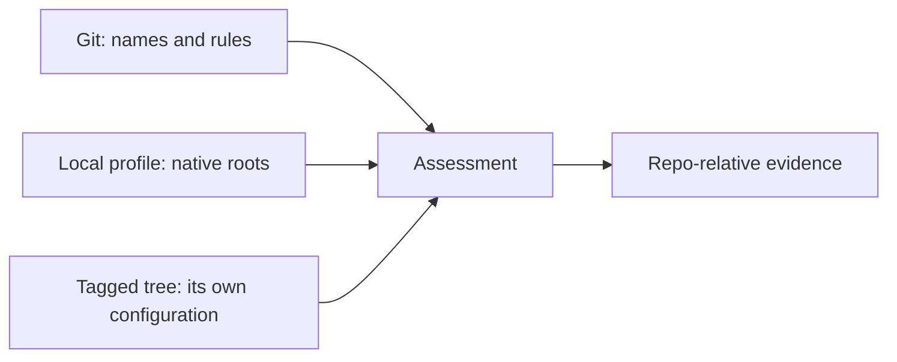

# Identity and checkout location

!!! abstract "TL;DR"

    A repository's name belongs to the project; its checkout address belongs to a machine.
    Moving a checkout changes neither its trace IDs nor the project's rules. V2 configuration
    makes that separation explicit, including layouts spanning Windows drives.

A service can live under `/work/apps/backend` on one machine and `D:\dev\backend` on another.
Both checkouts declare `repo = "service"`. A derived ID such as `service:src/service/keys.py`
and its evidence location still identify the same logical item. A workspace map supplies the
native address used to read it; output does not need to disclose that address.

V1 stored names and ledger-relative path defaults together. A map could override the addresses,
but copies still carried the defaults and their digest. V2 keeps membership as a set of names,
adds explicit local identity and uses `workspace_profile` as a portable default selector. An
initial conversion changes the schema digest. Later relocations do not.

A selected map is a whole layout. Falling back after an invalid selection could read the
wrong checkout; merging omitted entries from another source could produce a layout no one
selected. The tool refuses both. A genuinely absent implicit profile still permits useful
local evidence from a committed schema copy, with unavailable-source notices.

A profile locates current sources. It cannot establish historical configuration, pin a sibling,
verify report freshness or approve a change. Baselines read their own versioned trees, and
successful completion retains the same evidence limits. See
[names-only configuration](../reference/names-only-configuration.md) for the contract and
[the migration guide](../how-to/migrate-to-names-only.md) for the steps.
