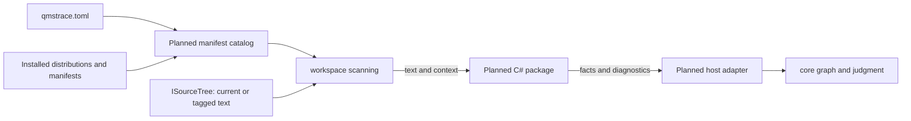
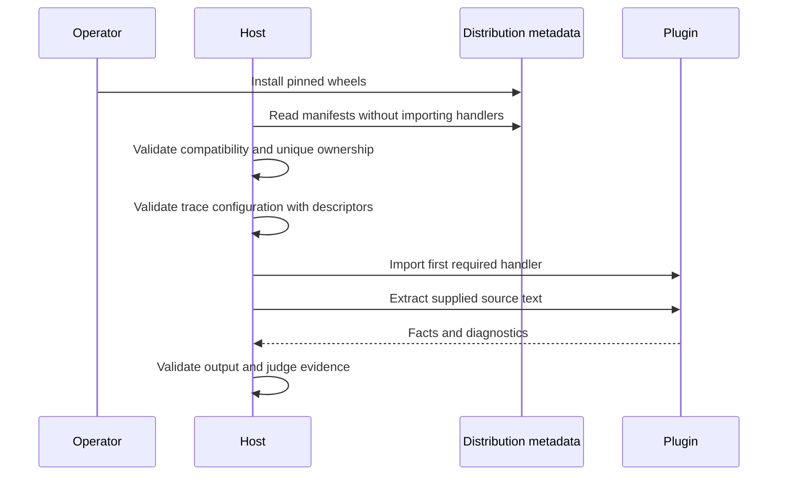

# qmstrace — Extensibility Architecture

> Source: the implementation direction accepted 2026-11-01; pre-change engine at `c6b40d9`.
> Mode: Design. Class: Hybrid, rungs 1, 2 and 4; primary seam: registered.
> Status: implemented under CR-007, accepted 2026-11-02. Release publication remains separate.
>
> See also: [System architecture](system-architecture.md) · [Data architecture](data-architecture.md) · [Surface architecture](surface-architecture.md) · [Codebase blueprint](../structure/codebase-blueprint.md) · [ADR-0013](../adr/0013-extractor-plugins.md) · [Implementation tracker](../progress/csharp-extractor-plugin.md).

## 1. Overview

Programming-language extraction becomes a capability supplied by independently versioned
Python distributions. The first package supplies the existing `csharp-file` and `xunit`
extractors. Trusted maintainers and collaborators author these packages. The host retains
source access, graph validity, coverage, baseline judgment and verdict propagation.

The host keeps only Markdown in its internal registry. Python module and pytest extraction
use the explicitly installed `qmstrace-lang-python` package under accepted CR-008
([ADR-0014](../adr/0014-python-extractor-plugin.md)). External source/test extraction
uses the **registered** shape: metadata admission followed by synchronous calls in
the host process. One invocation uses one fixed catalog. Package changes take effect on
the next invocation. No hot reload, event bus or worker process is needed.

The design combines installed-package discovery and a narrow public API with static
manifest admission. Its design input is the Extensibility Architecture skill's
`references/shapes.md`, Rung 4b — Registered. The local minimd and manifest-first toys
informed the comparison; neither is a build dependency or acceptance fixture.

## 2. Variability inventory and mutability map

| Concern | Who changes it | Who can forbid | Frequency | Trust | Hot? | Rung | Owner |
|---|---|---|---|---|---|---|---|
| Language syntax and markers | Plugin maintainer | Environment owner; host admission | Plugin release | Trusted code | No | 4 | C# package first |
| Installed package versions | Operator or CI owner | Environment owner | Tool upgrade | Pinned packages | No | 1 | Installation environment |
| Files and extractor names | Product repo author | Config validation and review | Repo change | Reviewed data | No | 1/2 | Trace configuration |
| Links and coverage | Schema author | Schema validation and review | Project change | Reviewed data | No | 2 | Trace schema |
| Capability declarations | Plugin maintainer | Host manifest validation | Plugin release | Declared data | No | 2 within 4 | Plugin manifest |
| Judgment and evidence policy | Host maintainer | Host review and release | Host release | Trusted core | No | 0 | Engine core |

Language parsing needs code and an independent release cadence, so rung 4 is justified.
Configuration and coverage retain their existing data mechanisms.



A parser update follows this path: publish a C# package, update the pinned installation,
start a new invocation, validate its manifest, resolve the configured extractor, import
its handler, extract facts, then apply the host's existing judgment. A compatible parser
update requires no host source edit or host release.

## 3. Runtime configuration — rung 1

The operator installs the plugin into the same Python environment as qmstrace. Existing
extractor names select installed capabilities; workspace maps continue to locate source
repositories, never executable plugins. No arbitrary repository-local module path or
automatic package download is introduced.

Discovery builds one catalog per invocation. Pure configuration parsing receives immutable
capability descriptors. Local, sibling and historical configuration all use that catalog.
Metadata resolution precedes extractor-specific validation; implementation imports do not.

## 4. Declarative composition — rung 2

Existing file globs, ignores, item types, links and coverage stay in trace configuration.
A plugin contributes extraction capabilities, not schema overrides or judgment rules.

The entry-point group is `qmstrace.extractors`. Each entry identifies a top-level import
package containing `plugin.toml`. Read the manifest without importing that package; prove
this for editable workspace installs and installed wheels. Distribution metadata owns
package name and version, avoiding a duplicate version field in the manifest.

The manifest declares its format version, supported API major and extractor entries.
Each entry supplies a name, entry module, derived-ID mode, named-link or single-link mode,
an identity description and optional scan guidance. Each module exposes `extract` and
`form`. The external v1 seam supports source/test identities derived from their location;
authored Markdown document identities remain host-owned.

## 5. Hooks and scripting — rung 3

Absent by decision. Extraction needs no before/after events, executable setup hooks or
plugin-contributed CLI commands.

## 6. Plugin mechanism — rung 4

| Decision | Accepted direction |
|---|---|
| Contract | Two required operations, immutable public input/output values |
| Manifest split | Contributions and compatibility known before import |
| Placement | Synchronous calls in the host process |
| Activation | First required use; cached within the invocation |
| Change landing | Next invocation after package installation/update |
| Compatibility | Stable API major independent of distribution versions |
| Core/plugin line | Plugins recognize syntax; host owns source access and judgment |
| Distribution | Independently versioned wheels in one uv workspace |
| Enforcement | Type checks, manifest/output validation, import boundaries and wheel tests |

### Public API

The public module is `qmstrace.plugin_api.v1`:

```python
def extract(request: ExtractRequest) -> Extraction: ...
def form(marker: str, target: str) -> str: ...
```

`ExtractRequest` supplies source text, a repo-relative POSIX path label, item-type name,
levels, recognized marker names and markers permitted for the item type. It supplies no
workspace, filesystem handle, config loader or graph.

`Extraction` holds immutable tuples of items, links, diagnostics and strays. Items retain
identity, type, source location, title, digest, fields, level and `runs_as` report
identities. Diagnostics distinguish parse failure, missing level, invalid ID and unread
marker; the host maps these to existing finding codes. Strays retain targets, location,
optional owner and language-specific corrective guidance.

Stable whole-ID recognition and content-digest helpers belong to the public API.
Language syntax normalization belongs to the plugin. A host adapter translates public
values to internal trace values. Plugins must not import internal core/config/graph types.

### Lifecycle and errors



- Missing required providers, unsupported APIs and ambiguous ownership stop assessment
  with exit 2 and an actionable diagnostic. There is no priority winner or fallback.
- Unselected invalid packages remain inspectable without blocking unrelated assessments.
- Unexpected handler exceptions or invalid values produce exit 3 with provider/extractor
  identity. A crash never becomes an empty successful extraction.
- Source problems remain findings. An empty extraction from irrelevant text is legitimate.

`qmstrace plugins` inspects distributions, API compatibility, declared extractors and
discovery problems in text or JSON, without a trace root or handler imports.

### Compatibility and provenance

API v1 remains stable across compatible host releases. Breaking required behavior needs
another API major. Plugin metadata declares the first compatible host version; runtime
admission checks API support. A separate SDK distribution is unnecessary initially.

Compatibility does not promise identical extracted evidence. Parser and grammar updates
can change IDs, digests, identities or recognized markers. One resolved environment reads
both current and tagged source during a comparison; historical configuration never installs
or executes historical plugin code.

Assessment/table JSON carries additive deterministic toolchain metadata: host and Python
versions, used provider versions, API versions and parser dependency versions. Existing
evidence notices and ordinary text output remain. Retain resolved environment constraints
and wheel hashes with compatibility results; plugin version alone cannot pin dependencies.

## 7. In-process extensions — rung 5

Absent as a supported mechanism. Plugins receive no host mutation interface. Python can
technically patch internals, but this is unsupported and checked in maintained plugin CI.

## 8. Trust, admission and the agent

The environment owner admits packages; configuration selects capabilities; the host checks
metadata. Scanned source files cannot install or activate a handler. An agent authors
plugins through the same reviewed package workflow.

Containment is **none**. In-process plugins can access the host's resources or hang it.
The text-only/no-filesystem contract is tested behavior, not a sandbox. Trusted Python
authors are the accepted audience. Independent runtimes or killable workers would require
a separate hosted-plugin decision.

## 9. Developer loop and packaging

The root remains the host project. `packages/qmstrace-lang-csharp` is a uv workspace member
with its own version, manifest, changelog, README, license and wheel. The root development
group includes it; the host's runtime dependencies do not. Parser dependencies move to
the C# package with their current ranges. Workspace source overrides serve development
only; one root lockfile resolves the development environment.

Build each wheel with `uv build --package NAME --wheel --no-sources`. Install both wheels
outside the checkout for acceptance. Host-only installs must have no C# parser dependency.
Keep the C# starter in the host; selecting it requires provider availability before writes.
Install a plugin with the host via `uv tool install --with`, never into an unrelated venv.

Host tags retain `vX.Y.Z`; plugin tags use `qmstrace-lang-csharp-vX.Y.Z`. Each package's
manifest owns its version; CI checks the corresponding tag, gates that tree and drafts its
release from its own changelog. Human publication remains separate. Private GitHub wheels
remain the distribution channel; no package index is added.

Markdown, change requests and JUnit/TRX readers stay in the
host. New-framework report normalization and new-language onboarding are separate work.

The seam test is falsifiable: install a fixture plugin without editing a host allowlist,
registry, renderer or judgment branch. Then update only the C# wheel against an identical
host wheel. Both are automated acceptance tests; measured runs and limits are in the implementation tracker.

## 10. Rung presence matrix

| Rung | Current / intended | Subsystem and audience |
|---|---|---|
| 0 Fixed | Present / retained | Judgment, host maintainers |
| 1 Config | Present / retained | Locations and selection, operators |
| 2 Declarative | Present / extended | Trace schema and manifests, authors |
| 3 Hooks | Absent / absent | No extraction need |
| 4 Plugins | Registered seam / retained | Language packages, trusted maintainers |
| 5 Rewrite | Absent / absent | No supported host rewriting |
| 6 Fork | Available / retained | MIT source, last resort |

## 11. Decisions and acceptance limits

The architecture, uv workspace and explicit installation choices are accepted. The
[tracker](../progress/csharp-extractor-plugin.md) owns implementation state and verification.
CR-007 is accepted and recorded in the configured ledger. The
[historical proposal](../progress/csharp-plugin-change-request.md) records its impact analysis.
The tracker records passing local dry gates and macOS/Linux installed-wheel evidence;
native Windows and historical released API-v1 combinations remain unverified.
A workspace lockfile tests one combination; it cannot establish compatibility across releases.


## 12. DSN-QMT-17 — Admit metadata, execute through a versioned text contract

The `plugin_api.v1` values contain no configuration, graph, workspace or filesystem handles.
The host validates their immutable shape and semantic locations before adapting them into
its internal graph values. The plugin owns syntax, report identities and corrective guidance;
the host maps diagnostic kinds to existing findings and owns evidence judgment.

`plugins.catalog.Catalog` reads installed distribution manifests without package imports,
including uv editable sources. The workspace creates it once and passes it through local,
sibling and baseline scans. It injects immutable descriptors into pure configuration parsing.
A selected absent, rejected or ambiguous provider refuses assessment. Unexpected execution or
contract failures identify the provider and exit 3, never an empty successful result.

Assessment values carry the resulting deterministic toolchain data to JSON renderers.
Metadata-only inspection is available before repository discovery. Distribution identity,
API support and parser versions come from package metadata, not executable setup hooks.

- Satisfies: REQ-QMT-24, REQ-QMT-25, REQ-QMT-26

### Implemented contract details

The manifest's top-level keys are `manifest = 1`, `api = 1`, `parser_dependencies` and
`[extractors.NAME]` tables. Each table requires `module`, `ids = "derived"`, `links = "named"`
or `"single"`, and `identity`; `scan` and `single_link_description` are optional text.
The distribution must declare an unconditional version-bounded `qmstrace` dependency.
Runtime admission checks both this range and API major support before handler import.

`ExtractRequest(text, path, item_type, levels, markers, permitted_markers)` uses tuples.
`Extraction(items, links, diagnostics, strays)` also uses tuples. An item's fields are a tuple
of unique string pairs; `runs_as` is a tuple of `(class, method)` pairs. Diagnostic kinds are
`parse`, `missing-level`, `invalid-id`, `unread-marker`, mapped to V08, V06, V14, V15.
Stray guidance contains the literal `{location}` placeholder, replaced after project path
qualification; its optional `kind` is descriptive data, never host language dispatch.
See `src/qmstrace/plugin_api/v1.py` for the complete typed declarations.

The package locator supports installed wheels and uv's local editable `direct_url.json`
metadata plus top-level import specs. It never resolves a dotted spec that could import a
parent package. Other editable backends and namespace packages are outside the first seam.

Assessment metadata is `data.toolchain`; tables use top-level `toolchain`. Provider versions
and parser dependencies are reported only for handlers used in that invocation. Configuration
inspection describes installed declarations without claiming execution acceptance.


Under CR-008, duplicate item IDs within a valid Extraction remain source evidence. The
adapter preserves all declarations and locations; graph validation emits V01. This accepted
validation relaxation restores Python compatibility without changing API v1 fields.
Extractor ownership still must be unique, and invalid DTOs, paths, types, digests, link
sources, marker names and targets remain plugin faults.
