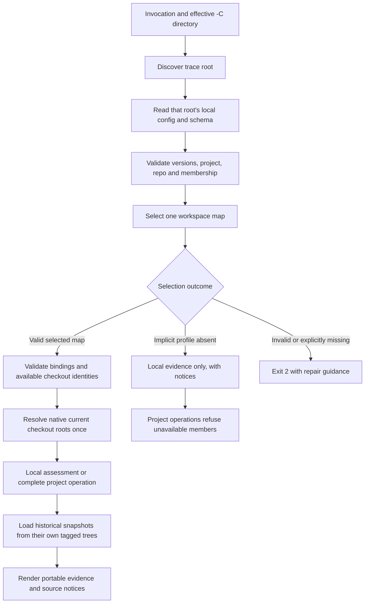

# Names-only configuration and workspace profiles

**Status: merged as PR #74 (`79841ec`), 2026-10-24; native acceptance verified; shipped in v0.3.0 at `a276e6e`.** The developer accepted three
design choices: every v2 trace configuration requires `workspace_profile`; 0.3.0 includes
cross-drive Windows layouts; `--json` consistently emits `qmstrace.cli/2`, including
handled parser errors. The examples below are v2 inputs, not v0.2.0 syntax.

Implementation state belongs in the [single active tracker](../progress/overview-qmstrace.md#landed--030-names-only-configuration).
[ADR-0012](../adr/0012-names-only-configuration.md) records the accepted amendment to
shipped design. The [acceptance protocol](../tests/names-only-workspaces.md) fixes live
measures before implementation or test-bed modification.

## Purpose and boundary

Git records which repositories participate, their stable names and the project's rules.
A developer or pipeline supplies where its checkouts live. Relocating them must require
only a local map edit, not a shared-schema edit or new generated copies.

V2 removes the local cross-repo `ledger` pointer and path-valued schema `[repos]` entries.
Repository-internal source globs, agreement/request paths and same-tree schema references
remain appropriate. This does not add pinned cross-repo traversal, fetching, report
freshness verification, automatic approval or baseline rewriting. No new runtime dependency
or persistent graph database is needed.

V1 remains readable, including historical configurations. Its path meanings and digest
algorithm remain intact. Input compatibility does not promise old machine-output formats
from the new release: 0.3.0's JSON has an explicit new version.

## Three authored inputs

### Shared trace schema: membership and rules

The ledger authors `qmstrace.schema.toml`; this excerpt replaces path-valued membership:

```toml
version = 2
project = "MINI"

[repos]
ledger_repo = "ledger"
members = ["ledger", "service", "client"]

# Existing item_types, links, rules, externals, change_requests,
# baselines and tables follow unchanged where their meaning is unchanged.
```

`members` is a nonempty set of unique repository identities, authored as an array. Input
order has no meaning; the v2 digest canonicalizes it in sorted order. `ledger_repo` is the
schema-owning role, not a path and not automatically a traced member. In this example it
is also a member because it declares documents. A schema-only ledger may stay outside the
member set; its v2 local file still declares its identity/profile, without local item types.

Use portable repository names, preserving case and existing names. Reject empty names,
duplicates, path separators and `:` because names also qualify item IDs. Renaming a member
is an identity migration, not a checkout relocation.

### Local trace configuration: identity and default selection

The service's committed `qmstrace.toml` starts with:

```toml
version = 2
repo = "service"
workspace_profile = "mini-service"

# Generated verified [schema] block and existing [subjects]/[items] follow.
```

The client's header names `repo = "client"`. The ledger's local file is:

```toml
version = 2
repo = "ledger"
workspace_profile = "mini-service"

[schema]
path = "qmstrace.schema.toml"

# Existing local subjects and item extraction declarations follow.
```

`repo` must be a schema member or the schema's ledger role. A role holding traced documents
must be in `members`. `workspace_profile` is a required portable filename stem, matching
`[a-z0-9][a-z0-9_-]*`, without directories or a `.toml` suffix. It is neither a filesystem
path nor an alternative project identity. Different repo defaults may name different
profiles; their names do not change the schema or authorize different membership.

Both fields live outside the generated schema block. V2 refuses the legacy local `ledger`
pointer and the old path-valued membership form, with migration guidance. V1 continues
to reject unsupported v2 keys rather than silently ignoring them.

`ledger copy-schema` generates membership inside the verified block as:

```toml
[schema.repos]
ledger_repo = "ledger"
members = ["ledger", "service", "client"]
```

The complete generated block also carries schema version 2, project, rules and its generated
digest. The excerpt is not a substitute for that block. Moving from v1 to v2 changes the
shared-schema digest and requires regenerated copies; later map changes do not.

### Workspace map: machine-specific locations

`~/.qmstrace/workspaces/mini-service.toml` keeps the existing map format:

```toml
version = 1
project = "MINI"
ledger_repo = "ledger"

[repos]
ledger = "/work/records/projects/mini-service"
service = "/work/apps/backend"
client = "/work/other/frontend"
```

Each developer supplies different paths under the same logical profile name. Windows may
place the ledger on `C:`, service on `D:` and client on `E:`. Map version stays 1 because
its syntax already expresses native paths; 0.3.0 removes the old cross-drive output limit.

Entries may be native absolute paths or paths relative to the selected file's canonical
directory. Selecting a symlink uses its target's directory. No interpolation of environment
variables or `~` occurs inside TOML. A ledger entry names the trace root, which can be nested
inside a larger Git repository. Local maps stay out of shared Git configuration.

## End-to-end resolution



1. Resolve `-C`, report/output arguments and a relative `--workspace FILE` from the effective
   invocation directory before repo discovery, preserving root/leaf conventions and duplicate
   refusal. Help/version remain eager and inspect no map or repository.
2. Discover the trace root and load its local configuration/schema. A map cannot supply or
   repair an unreadable `[schema] path`. A copied schema permits a product-only checkout;
   a same-tree by-path schema permits the ledger's own configuration. Validate the local
   identity against the schema before reading other checkout contents.
3. For v2, select the first applicable source: explicit `--workspace FILE`, nonempty
   `QMSTRACE_WORKSPACE`, nearest ancestor `.qmstrace/workspace.toml`, then exactly
   `~/.qmstrace/workspaces/<workspace_profile>.toml`. Do not enumerate unrelated user files
   or infer another profile from the project name. V1 retains ADR-0010's existing discovery
   and tracked-default fallback, including its strict user-candidate validation.
4. Distinguish a genuinely absent implicit named file from an unreadable/malformed file,
   dangling symlink or incorrect binding. Only absence permits local-only operation. An
   explicitly selected missing file, invalid default or invalid higher-priority source is
   exit 2, with no fallback to another source. Lower-priority files remain unread.
5. Check project and ledger-role agreement, permitted member keys, duplicate canonical roots
   and the exact binding `map.repos[local.repo] == current trace root`. Validate identities
   of available mapped checkouts before using them; a readable contradictory project/repo
   identity is exit 2. A missing source stays unavailable. Membership comes from the schema,
   never the map. A partial selected map cannot borrow any omitted member from another map
   or from a v1 path default.
6. Local commands assess available evidence and keep notices for unavailable siblings,
   agreements and request registers. Without a map, the ledger can still read its known
   local sources; a product cannot guess a ledger. V2 project operations require a map and
   all assessed members with coherent schema copies; v1 retains its tracked-default path.
   Ledger commands still require invocation
   at the ledger trace root; profile selection cannot redirect a product invocation there.
   `copy-schema [REPO...]` validates all explicitly selected destinations before any write.
7. Read every baseline through the tagged tree and its own versioned configuration/schema.
   Current maps only locate current checkouts. Preserve offline object/history checks,
   subject ownership, withdrawals, suspects, report matching and existing exit policies.

`paths` remains a configuration/location diagnostic: no item scan, report, baseline or Git
assessment. It reports profile provenance, identity, logical roots and availability. A map
is operational input, never evidence that sources are approved, pinned or fresh.

## Portable locations and machine output

Native roots belong to infrastructure. Evidence uses a repository identity plus a path
relative to its trace root and, where meaningful, a line:

```json
{"repo": "service", "path": "src/service/keys.py", "line": 7}
```

Human project output can render `service:src/service/keys.py:7`; local output may omit its
own repo prefix. This is a location label, not a changed item ID. Keep authored document
IDs and existing repo-qualified derived IDs intact. For legacy local input whose repo
identity cannot be established, JSON uses `repo: null` to mean the current trace root;
never infer identity from a folder basename.

Human location spelling intentionally changes in 0.3.0; v1 input compatibility is not a
promise of 0.2.0 output bytes. Determinism and ANSI-stripped/plain parity still apply within
the new presentation contract.

Cross-drive conversion never calls filesystem `relpath` between different repo roots.
Compute a source's relative path only within its owning repo. Absolute native checkout
roots are not generated into shared evidence or diagnostics. `paths` uses logical roots
such as `service:.`, a profile filename/source and availability; the local map holds the
actual native locations. External report labels retain their existing basename/digest
rules rather than inventing a repo-relative path for an out-of-repo file. Literal authored
content remains literal; the restriction concerns tool-generated operational paths.

`qmstrace.cli/2` is uniform for `--json` across all 0.3.0 invocations, including v1 inputs,
handled parser failures and domain/internal errors. Preserve envelope fields, exit meanings,
notices, quiet completeness, serialization-before-write and deterministic UTF-8 formatting.
Project membership is names/role data, not the old path dictionary. Locations become explicit
records. Publish the complete schema and migration examples before the implementation ships.
No legacy output selector is added; consumers needing `/1` remain pinned to 0.2.0.

**Accepted output amendment:** use `qmstrace.table/2` for 0.3.0 table output as well, because
its repo-read locations must change for cross-drive layouts. Do not silently redefine
`table/1` or pretend repo-qualified locations are ledger-relative filesystem paths. Preserve
table kinds, configured columns, verdict aggregation and draft/evidence meaning. The redundant
table `--json` flag still emits the same table document; writing refusals remain in force.

## Migration and setup

Supported assessment pairs are local-v1/schema-v1 and local-v2/schema-v2. Refuse mixed pairs
with an actionable migration diagnostic. Schema-only v1 ledgers remain supported. V2 ledgers
carry local identity/profile metadata even when the ledger role declares no traced items.

1. Upgrade the CLI before changing consumer syntax. Record clean repo states and baseline
   results, and prepare v2 files on coordinated branches. Do not edit baseline tags.
2. Author the shared v2 schema and ledger's matching local header. Preserve its schema path,
   declared items, rules, subjects and controlled source text.
3. Stage each product's v2 header and preserve local declarations. An intact older verified
   block, or an empty `[schema]` placeholder for bootstrap, may exist temporarily as input
   to schema-copy planning. That transient file is not assessable v2 configuration.
4. The v2 writer validates destination header identity/profile and the old held block, builds
   complete v2 candidates from the authoritative ledger, validates every candidate and then
   writes all selected blocks transactionally. It preserves bytes outside those blocks.
   A second run is a no-op; ordinary assessment never accepts the transitional mixed pair.
5. Run `init` on valid v2 configurations to refresh managed guidance without replacing local
   additions or workspace maps; review every diff. Then compare logical assessments, historical
   comparisons and generated copies before merging the coordinated consumer changes.

**Accepted setup scope:** preserve existing v1 starter generation when `init` creates a
new configuration. Add v2 refresh support and document explicit v2 bootstrap/migration;
do not add a migration command, infer repo names or broaden init's overwrite policy in 0.3.0.
New v2 starter automation can follow if the manual workflow proves insufficient.

The project-check requirement uses representation-neutral membership wording. Before editing,
the current baseline assessment confirmed REQ-QMT-17 is a new controlled item, not frozen;
accepted CR-001 already covers it. Its citation remains. No baseline tag or request acceptance
state is changed. The earlier planning assumption that this item was frozen was incorrect.

## Implementation sequence and ownership

| Slice | Working vertical increment | Owners and completion evidence |
|---|---|---|
| A — identities and discovery | Read v1/v2, resolve named maps, inspect `rules`/`paths` and produce uniform CLI `/2` outcomes | `core/config/` owns versioned membership; `core/locations.py` owns pure map/identity validation; `infra/locations.py` owns discovery/native roots; CLI/render owners own explicit projections. Parser/history/profile and error goldens pass |
| B — portable assessments | Local/project graphs, source notices, baselines, thread/impact, reports and tables work across relocated roots and drives | Existing `workspace/` owners resolve once, then pass native roots and portable locations; `GitTree` reads historical sources independently; core judgment and verdict algorithms remain authoritative. Table `/2`, command/HTML evidence and native Windows tests pass |
| C — authoring and delivery | Transactional v2 schema-copy/bootstrap, managed guidance and complete migration documentation | `core/setup/` and `workspace/_setup.py` preserve copy ownership and rollback. Package/manual/skill assets, live test-bed measures, dry gate and strict trace gates pass |

Keep compatibility imports and `qmstrace.cli:app`. Normalize version-specific input behind
the existing configuration/location boundaries; do not push native paths into core judgment
or introduce a parallel workspace service. Audit every consumer of `config.repos`, relative
location strings and qualified IDs before replacing the internal representation.

Amend the PRD, glossary, data/surface design, ownership notes and scenario catalogue as the
slices land. Ship Diátaxis v2 configuration/profile references, a v1-to-v2 how-to, developer/CI
layout guides, output-contract migration guidance and an explanation of identity versus
checkout location. Update command help, bundled/installed skill, packaged schemas and the
Unreleased changelog from tested examples. Do not publish unsupported examples as current
manual behavior before the corresponding increment works.

## Completion and remaining review

Pass the [acceptance measures](../tests/names-only-workspaces.md), focused tests, `just dry`,
installed-wheel checks and both strict trace gates. Inspect every changed golden and the built
manual. Record measured results and all unverified platforms/evidence limits in the tracker.
Native Windows cross-drive proof is a release gate; POSIX path mocks do not satisfy it.

The three form decisions and both table/setup amendments are accepted. Implementation,
source-level/live checks and native Windows proof are recorded in the tracker and acceptance
results. PR #74 merged the implementation. Consumer migration and release publication remain
separate actions.
