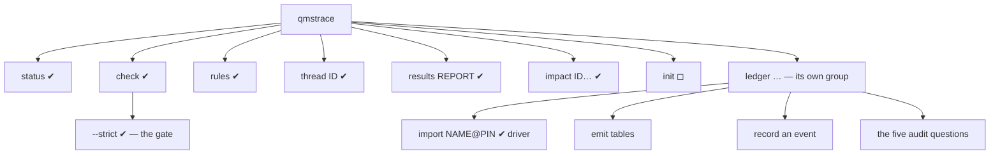
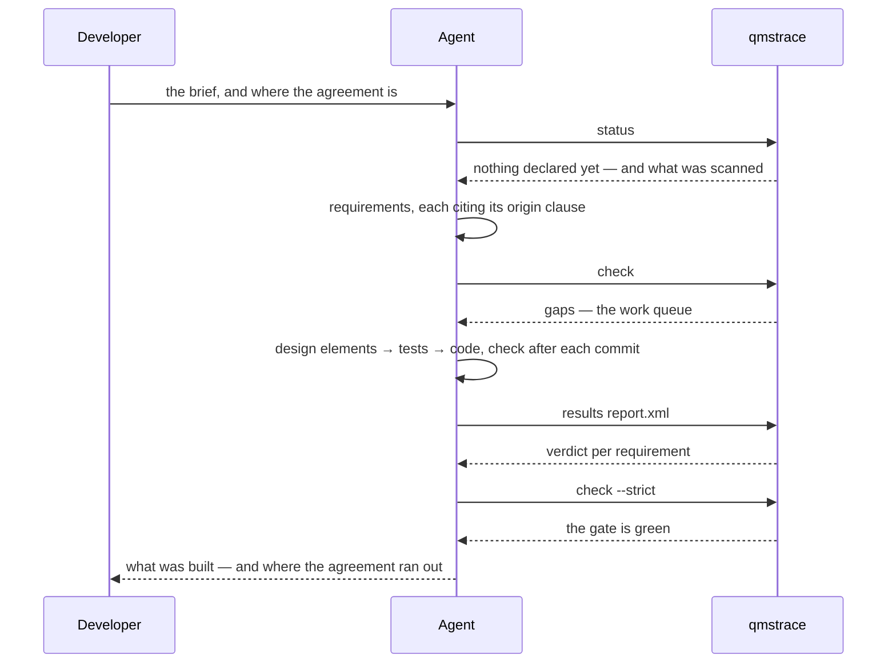
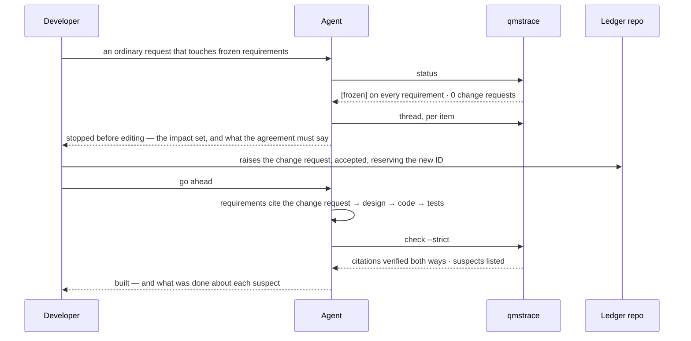
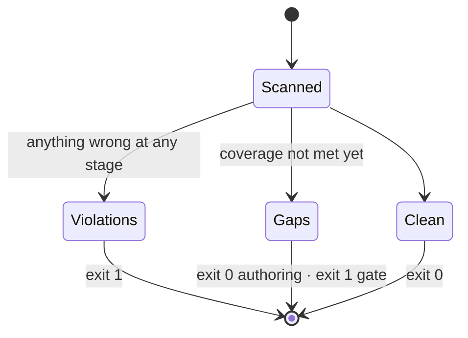

# qmstrace — User-Facing Surface & Agent Experience

> Source: the PRD, experiments E1, E3 and E4 on the beacon test bed, and the design conversation behind decisions D1–D7 · Date: 2026-09-21 · Mode: Design · Surface: Hybrid — a command line (primary), generated documents, a generated read-only view
> See also: [Data Architecture](data-architecture.md) · [Product Requirements](../req/qmstrace-prd.md) · [Experiments](../tests/beacon-authoring-experiment.md)

Terms follow [`CONTEXT.md`](../../CONTEXT.md). Two marks are used throughout: **✔ validated**
— exercised on the test bed by an agent that had nothing but the repo's guide, the skill and
tool output; **◻ planned** — named in the PRD or a decision, not yet tried.

## Cheat Sheet

The product-repo loop, in the order it is used. All six are ✔ validated.

```sh
qmstrace status                 # what was scanned; one line per requirement; what is frozen
qmstrace rules                  # what this repo counts as covered — the rules, from their source
qmstrace check                  # violations and gaps while authoring — gaps do not fail
qmstrace thread REQ-XYZ-05       # one thread: back to the origin, forward to the tests
qmstrace results report.xml     # the verdict per requirement, from a test-run report
qmstrace check --strict         # the gate: no violations, no gaps
```

## 1. Overview

qmstrace answers an auditor's questions by query. Its users never meet a database or a web
application: they meet **a command line in the repository they are already working in**,
**documents in the word processor they already use**, and, for an audit, **a page
someone else drives**.

**Surface type: hybrid.** The PRD names four users, and each has a different surface:

| User | Surface | Status |
|---|---|---|
| The coding agent in a product repo — first-class | the command line; the stanza, the skill, the markers | ✔ validated |
| The developer-manager | the same command line; the pull-request diff | ✔ command line · ◻ diff of the trace lock |
| Reviewers and approvers | rendered Word drafts, in the document store. **They install nothing** | ◻ planned |
| The auditor | a generated, read-only view, driven by someone else | ◻ planned |

The engine is a tool **installed into** a product repo or a ledger repo; it holds no project
data. There are two launch sites, one per hat: the product repo for the daily, developer-side
loop, and the ledger repo for the occasional, manager-side acts (D5).

## 2. Surface Map

### Commands



| Touchpoint | What the user does with it | Status |
|---|---|---|
| `qmstrace status` | Sees what was scanned — items and files per item type, and the files each type ignores — what lies around the repo and whether it was verified, then one line per requirement: origin, design elements, test cases by level, and whether it is `[frozen]`, `[changed: CR-…]` or `[new …]`. Requirements verified by inspection or analysis are listed apart. Not a check: it exits 0 whatever it counts. *In the engine since M2; its golden is `tests/cli/golden/`* | ✔ |
| `qmstrace check` | Lists every violation and gap in one pass, each with file, line and what to do next — a gap's next move names the marker's form, the violation that refused its link, or the stray line that is not read. *In the engine since M3* | ✔ |
| `qmstrace check --strict` | The gate: the same findings, and gaps fail | ✔ |
| `qmstrace rules` | Reads the link types, required fields, coverage rules and what each baseline freezes — printed from the trace configuration, not from documentation, each part labelled as the project's or the repo's; a rule this repo cannot meet, or that applies to nothing here, says so. *In the engine since M3* | ✔ |
| `qmstrace thread <ID>` | Walks one item backward to what it derives from and forward to what hangs off it — any ID the run can see: a requirement, a test, a clause, a sibling's item. Each item once, nearest first, under the link that reaches it first; `Assumes` followed forward, not backward; it stops at this repo's edge. An unknown ID is *could not judge*, with the closest IDs. *In the engine since M2b* | ✔ |
| `qmstrace results <report>` | Matches one pytest JUnit report to scanned tests and direct `verifies` links; labels counts, shared tests and unmatched entries. Informational even on failure. *In the engine since M4* | ✔ |
| `qmstrace impact <ID>…` | Shows the starting items, their downstream union grouped by type, and their upstream origins. Prints a candidate `Impacts` line from configured baseline types, with source limitations visible. *In the engine since M3b* | ✔ |
| `qmstrace init` | Generates the trace configuration and the stanza in a product repo | ◻ |
| `qmstrace ledger import NAME@PIN …` | In the ledger: reads each product repo at a pin, judges the project as a whole, writes the trace lock. Exercised by the driver of the fourth experiment, not yet by an agent | ✔ (driver) |
| `qmstrace ledger …` — the rest | Emit tables for the render machine; record an event with an evidence pointer; the work-product register; the five audit questions, one command each | ◻ |

**M5a — decided 2026-09-22.** `status` reports governing tags and document comparisons;
`check` emits V10–V13. Frozen counts include changed and removed items; new and current
withdrawn counts are labelled separately. Annotation metadata is collected, lightweight tags
are weaker evidence, and local-tag judgment never certifies remote completeness. Baselines
and requests are structured assessment data, computed once for informational commands too.
An unusable historical schema, incomplete local history or incomparable governing tags is
exit 2, not partial judgment. Same-tree schemas and embedded copies are accepted at a tag;
today's external schema cannot substitute. Fresh request citations are checked against exact
accepted values and impact membership; unreadable registers retain a quiet-safe notice.
Malformed register files are violations. Withdrawn endpoints do not count for coverage;
graph traversal and test-result evidence remain visible and labelled.

**M5b suspects:** `status` lists nearest (distance-one) suspects in full and counts farther
items by their minimum distance, with a unique-item total and a pointer to `check`.
`check` and `check --quiet` list every S01 with its current location, contributing changed
or removed roots, governing tags, graph-version reach and unchanged/edited state. Sort by
minimum distance then ID; reasons by root and baseline. A dependant can be unchanged against
one root's snapshot and edited against another. `Review:` names the next move; it records
no approval. Counts remain in the check result line. Suspects never affect exits, including
strict mode. Current source notices and historical boundary limits survive quiet output.

Baseline and current graph walks are independent and include `Assumes`; a removed link
cannot erase historical reach. Only local dependants existing in the upstream snapshot and
today are reported. A downstream-only baseline cannot clear another root's chain.
`thread`, `impact` and `results` retain their existing views; the complete historical/current
suspect list belongs to `check`. See data architecture D7 for eligibility and clearance.

**M3b input handling — decided 2026-09-21.** If any starting ID passed to `impact` is not
visible to the run, the whole request exits 2, with no partial impact listing and no
copyable `Impacts:` line. The diagnostic names the unseen IDs, offers nearby matches and
says which sources could not be read. An unseen ID is not presumed to be reserved by a
change request. M5a reports a reservation when a readable accepted request lists the ID,
but still requires declaration before traversal. **Rejected:** showing the known subset
with an incomplete label and exit 2 — a reader could still copy it as the complete list.

**M3b impact contract.** Starts and downstream items appear once in their respective sections;
downstream groups follow schema item-type order, with IDs sorted within each group. Argument
order and repetition do not change the bytes. Upstream origins come from the starts alone,
using the external types in the configuration. An `Assumes` link carries impact forward,
but establishes no ancestry backward. When an ordinary path also reaches an assumed item,
the backward traversal uses the ordinary path and keeps the assumption as `also` — otherwise
the order of discovery could hide a legitimate origin. This also applies to `thread`.

The candidate `Impacts:` line is the sorted union of starts and downstream items whose types
appear in any configured baseline's `covers`. It does not inspect tags or assert that an item
is frozen, nor assert that every affected item needs editing. Upstream-only origins stay out
of the candidate. Unknown types are explicitly omitted; an empty candidate gets a reason
instead of a copyable empty line. **Rejected:** including all reached IDs irrespective of
baseline coverage, which would turn contextual origins and review-only types into controlled
changes. Actual edits remain a human decision.

Like `thread`, a produced walk exits 0 even when it reports violations; `check` remains the
gate. Notices, unavailable sources and refused links remain visible. Sibling nodes are not
pinned, and their own links are not scanned. Output ends with labelled counts and *this repo
only*. M5a's assessment reads reservations and baseline evidence; project-wide
traversal at pins belongs to the ledger.

### Results contract — M4

`results REPORT` reads one explicitly supplied file, including an ignored file. Relative
paths resolve from the effective invocation directory (`-C` on either side of the command),
before repository discovery. **Rejected:** resolving from the discovered root, which could
silently read a different report when invoked from a subdirectory.

Default pytest JUnit `xunit1` and `xunit2` are supported. Matching is exact on `classname`
and the unparameterized function name derived from scanned pytest node IDs; class methods
retain their class ancestry. Parameter suffixes start at the first `[`, so bracketed parameter
IDs remain distinct runs. Ambiguous, missing and unmatched identities are listed, never guessed.
The XML reader accepts `testsuite` / `testsuites`, nested suites and namespaces; it forbids
DTDs, entities and external references. Unreadable, malformed, unsupported and empty reports
are usage/report errors.

Counts distinguish XML entries, distinct full-identity runs, matched runs, matched test cases,
scanned test cases and unmatched run identities. Duplicate full identities combine by worst
verdict, with an explicit duplicate count, not an inferred retry history. Test-case verdicts
are `fail > skip > pass`; XML errors count as failures. Xfail/xpass follow their XML outcome.
A linked test missing from the report is `no-result`. Requirement verdicts combine direct
linked tests as `fail > no-result > skip > pass`; no linked tests means `untested`. A partial
parameter set does not prove all possible variants ran.

Only direct `verifies` links contribute. No verdict flows through a design element. Links are
deduplicated before counting, shared tests name other targets, and global counts count each
case once even when requirement rows overlap. Sibling requirements verified by local tests
are labelled with their owner and unpinned source; their declared verification method is
retained. Untyped citations stay outside requirement verdicts. Inspection/analysis requirements
are separate; linked test outcomes neither change the method nor establish approval.

**Decided 2026-09-21:** a produced view exits 0 whenever at least one test matches, including
failed tests and partial matches. Every unmatched entry remains visible. Zero matches exits 2
with diagnostics and no requirement verdicts. Internal faults exit 3. **Rejected:** failing
on a nonpassing test (pytest already owns that gate), or rejecting partial reports (which
would discard recognized evidence). No gate, quiet or JSON option is added.

Every view preserves unread-source notices and graph violations, states that it matches the
current working tree, labels the report commit **NOT VERIFIED**, and ends with counts and
exit code. M4 does not persist results, combine reports, verify freshness or reconstruct retries.

### The authoring surface

An agent spends far more time *writing* to this surface than invoking it.

| Touchpoint | What it is | Status |
|---|---|---|
| **Markers** | Item headings and link lines in repo memory; a docstring line in a module; the test framework's own tag on a test. Syntax: [Data Architecture § Marker syntax v0](data-architecture.md) | ✔ |
| **The stanza** | A generated block of about ten lines in the product repo's agent guide: the repo is traced, the ID patterns, start with `status`, the gate command, frozen items change only through a change request, a marker states a fact, never type a date or a verdict | ✔ |
| **The skill** | Shipped with the engine: the chain, the markers, the loop, how to read findings, what the tool cannot check. **It never restates a rule — it points at `qmstrace rules`.** Its ban on typed facts covers traced documents and test results; a tracker may cite a commit hash, as a pointer and never as evidence | ✔ |
| **The trace configuration** | One file at the repo root: item types, link types, coverage rules, externals, baselines, change requests | ✔ |
| **The trace lock's diff** | What a reviewer reads in a pull request when traceability changes (D1) | ◻ |

### Surfaces that are not a command line

| Touchpoint | What the user does with it | Status |
|---|---|---|
| Rendered Word drafts | A reviewer reads, edits prose and signs. Generated tables are read-only; a draft can never be mistaken for an issued revision | ◻ — the render machine exists in a predecessor; nothing here drives it yet |
| Reconcile | A reviewer's prose edits come back to the source as a patch an agent proposes and a person reviews (D3) | ◻ |
| The read-only trace view | During an audit, one person drives a generated page and follows a thread from claim to evidence | ◻ |
| **The user manual** | A developer-manager, or anyone adopting qmstrace, learns it — tutorials, how-to guides, reference, explanation — at <https://qmstrace.netlify.app/>. Written with the code, one slice at a time, and a probe of it: a page that must warn about a caveat is a design finding. Its reference includes goldens, never retyped output. Agents are steered by tool output and the skill instead | ✔ foundation (M2c) |

## 3. Entry & Onboarding

**In a product repo** ◻ — `qmstrace init` writes the trace configuration and the stanza; the skill
arrives with the engine. The first command is `qmstrace status`. Both experiments started this way
by hand, and in both the agent learned what mattered from that first command:

> "The block surfaced in the first command I ran. `iso status` prints `[frozen]` per item and
> `change requests: … (0 declared)` on the same screen. I knew the work was gated before I had
> opened a single source file."
>
> *(Verbatim. The tool was then called `iso`.)*

**For a reviewer** — nothing. The document arrives in the store they already use.

**For an existing repo with no markers** ◻ — a curator pass proposes markers after the fact
(option C in D5), reviewed like any other change. Its links are inferred, so it is an on-ramp,
not a way of working.

## 4. Key User Journeys

### A greenfield slice ✔ (E1)



The gap list was the agent's work queue; it drained from 26 to none. Three times the
agreement ran out, and each time the agent refused to invent an origin and raised an open
question for the customer instead.

### A change after a baseline ✔ (E3)



Writing the impact analysis is what made the agent notice that the request as worded would
not solve the problem behind it. A change-control step that improves the requirement is
worth more than one that only delays it.

### An audit ◻

The five questions of the PRD's success criteria, one command each: every work product with
its version history · the baselined requirements, design, test cases and code · one change
request end to end · one requirement forward to a passed test · a verification or validation
record for every work product the plan marks for one. E3 already produced the third thread by
hand; nothing assembles it yet.

## 5. Interaction & State

### What a check can come back with



| Exit | Meaning |
|---|---|
| `0` | Command completed. Informational views may contain failures; a check has no failing findings in this mode |
| `1` | **The check failed** — violations, or gaps under the gate. The result line says which |
| `2` | **Could not judge** — usage, configuration, the wrong kind of repo, an unknown ID, an unreadable report, incomplete local Git evidence, ambiguous governing tags or an unrecoverable historical schema |
| `3` | Internal error |

The command-line framework already exits `1` on an abort and `2` on a usage error, so this
taxonomy never fights it — and it is the convention of the linters a pipeline already runs. The
first form kept gaps and violations on separate codes and put usage on `3`; a mistyped option
would then have read as violations. A pipeline needs pass or fail; the split between gaps and
violations is what the gate flag already encodes, and the result line carries it.

The result line states the counts, the exit code and the mode, and **names the gate** — an
agent that reads only the last line still learns which command a pipeline should call.

### The findings contract

Every finding is one line: **code · file:line · what is wrong · what to do next.**

```
V09  docs/req/x-srs.md:92  REQ-XYZ-10 → Origin → AGR-9: the agreement declares no AGR-9 (it
     declares AGR-1 … AGR-5). Fix: cite a real one, or tell the developer that nothing covers
     this — never invent one.
```

- **Codes are stable and classed**: `V` violations, `G` gaps, `S` suspects. Gap codes belong
  to the repo's own coverage rules; violation and suspect codes belong to the engine.
- **All findings in one pass**, sorted, deterministic — never the first error and stop.
- **Every violation ends with the next move**, and where the wrong move is tempting it says
  so: *never invent one* · *do not edit the ledger yourself* · *stop and ask the developer*.
- Kinds of finding and what each fails: [Data Architecture § Kinds of finding](data-architecture.md).

### States that must never look alike

| Looks like | But is | The surface must |
|---|---|---|
| "Nothing declared yet" | An item declared in a file that is not read for its type | Report it as a violation naming the right file pattern; show items *and files* scanned per type |
| "External IDs are fine" | Their source could not be reached | Say **not verified**, in the header of every run |
| "Two counts that disagree" | Test cases versus runs of them | Label every count |
| "This requirement failed" | A test case that verifies several items failed | Mark the test case **shared**, with what else it verifies |
| "No suspects" | The suspects were cleared by touching a file | Never let a suspect clear itself (D7) |
| "An empty project" | A pin older than the repo's trace configuration | Refuse the import and say why |
| "Nothing is frozen" | A shallow clone, excluded tags, or not a repository at all | Exit *could not judge* for known incomplete evidence; otherwise report matching reachable local tags and keep remote-tag completeness unverified |
| "Verified" | The ledger is not beside the repo | *Not verified* in the result line, surviving the quiet form; the citation is verified at the ledger's import |
| "Covered" | `Verify-by: inspection`, with nothing recorded anywhere | List such items apart, until an inspection has a recorded basis |

## 6. Information Architecture / API Ergonomics

**The name is `qmstrace`** — for the repository, the package, the import and the command: one
spelling everywhere, so an agent has one thing to get right. It says what the tool is — the
trace layer under a quality-management system, where *trace* covers state tracking,
traceability and the audit trail alike — and it claims no more than that: not a quality
system itself, no document control, no signatures. It names no standard, because the
standard is data (PRD goal 6).

- **Rejected — `iso`**, the test bed's name: it is the standards body's own name, it collides
  with disk-image tooling, and it ties the tool to one family of standards.
- **Rejected — `qmsx`**: a trailing `x` on a command already means *run a package without
  installing it* (`npx`, `uvx`, `pipx`, `bunx`), so to a developer — and to a model trained on
  that convention — it implies the wrong thing; and "QMS, extended" promises a quality system.
- **Cost accepted:** the name contains `trace`, so the verb that walks one item back to its
  origin and forward to its tests is **`thread`**, not `trace` — already this project's word
  for it: *follow a thread from claim to evidence*. The name also contains `strace`; a reader
  may misparse it once.

**The verbs are the questions.** `status` — where am I; `rules` — what is expected; `check` —
what is wrong; `thread` — what hangs off this; `results` — did it pass; `impact` — what would
change. An agent asked for exactly one verb that was missing, and nothing else.

**One binary; the ledger's verbs sit under a group of their own** — `qmstrace ledger import …`,
never beside `check`. The product-repo loop stays six verbs wide, and an agent reading the
help in a product repo does not see verbs it must not use. A verb run in the wrong kind of
repo says so and names the right place.

### Agent experience

The agent is the first-class consumer of this surface, and what follows is evidence, not
aspiration — each line is a defect found, or a behaviour observed, on the test bed.

- **Steer by tool output first, prose second.** In both experiments the agent learned what
  mattered from the first command it ran. The stanza is ten lines; the tool does the rest.
- **No rule is hidden.** A rule that lives in code, or in prose that disagrees with the code,
  is a defect. Three of E1's six defects were this one. Rules are data; `rules` prints them;
  the skill points at the command.
- **An empty result must not look like a misconfiguration.**
- **Errors teach the next move**, and name the tempting wrong one.
- **A signal must not clear itself.** A suspect that disappears when a file is touched is
  worse than no suspect: it reports a review that did not happen.
- **Output is economical and deterministic**: a header of a few lines, one line per finding,
  sorted; the same input gives the same bytes.
- **A refusal comes with a deliverable.** "Stop and ask" is paired with what to hand over —
  the impact set, and what the agreement would have to say differently — so the gate is a
  step, not a dead end.
- **The tool is on the path, and finds its root.** The test bed invoked it by a relative path,
  which cost the agent a directory change before every command. The engine walks up to the
  trace configuration, and `-C <path>` — before the verb, as with `git -C`, or after it — runs it
  elsewhere; given on both sides it is a usage error.
- **The header stays short.** By the fourth experiment it had grown to eight lines before the
  first finding — "running `check` in a loop, that is most of the output". A quiet form that
  prints only findings is wanted; what was scanned belongs to `status`.
- **The stanza names the subject.** The guide said `<subject>-srs.md` and nothing said what
  the subject was called; the agent guessed.
- **The loop includes breaking the code.** The check verifies that a marker exists; only a
  broken requirement shows whether the tagged test would notice. An agent that ran this pass
  unasked found a marker in its own work that could not fail. The skill's loop gains the step
  — *break it, watch the tagged test fail* — between checking and the gate. It took minutes.

### What the surface cannot do, and says so

Four rules bind an agent that no check can enforce; the skill states them, and review
catches what it can. **The verdict has to land on whoever can act on it** — a marker across a
repo boundary can be true and still put a failure on the wrong team's requirement. **A marker
states a fact** — tag a test with a requirement only if the
test would fail when the requirement is broken. **A requirement describes every
configuration** — a new setting with a no-op default still changes the text. **When a
requirement is gated, the work downstream of it is gated too.**

## 7. Configuration & Customization

- **The trace configuration** is the whole of it for a product repo: item types and their
  file patterns, link types, coverage rules, externals, baselines, change requests. Shape and
  reasoning: [Data Architecture § The trace configuration](data-architecture.md).
- **The stanza is generated**, between markers, from the trace configuration. It is edited by
  editing the configuration.
- **Baselines are recognised, not imposed**: a project's own tag names are configuration (D6).
- **Machine-readable output comes later, and findings are structured from the first line of
  code.** No agent has needed a `--json` form — line output was enough in every experiment —
  but the pull-request gate and the trace browser will. So a finding is data inside the
  engine — code, file, line, item, what is wrong, the next move — and the line an agent reads
  is one renderer of it. Which commands get the form, and its versioning, are decided then.

## 8. Decisions needed

Each is marked 💡 where it bites.

| # | Decision | Where |
|---|---|---|
| 1 | **The gate's shape.** `check --strict` was enough on the test bed. In the engine a gap fails only from its rule's stage on, so the gate needs to know the stage — a flag, the trace configuration, or the ledger. **Settled for slice 1 (2026-09-21): the gate fails on every gap**; stage-aware gating waits for the ledger, where the project's stages live | §5 |
| 2 | **A quiet form of `check`**, and how much of the header survives in the default form. **Settled in M3; extended M5a:** the default form keeps one `read:` line and evidence notices; `--quiet` keeps the notices, findings and result line. The result line carries baseline counts, remote-tag completeness and unavailable-request limitations | §6 |
| 3 | **The reviewer's and the auditor's surfaces are unvalidated.** Draft marking, read-only tables, reconcile and the read-only view are decisions on paper (D3, the PRD); none has met a reviewer | §2 |
