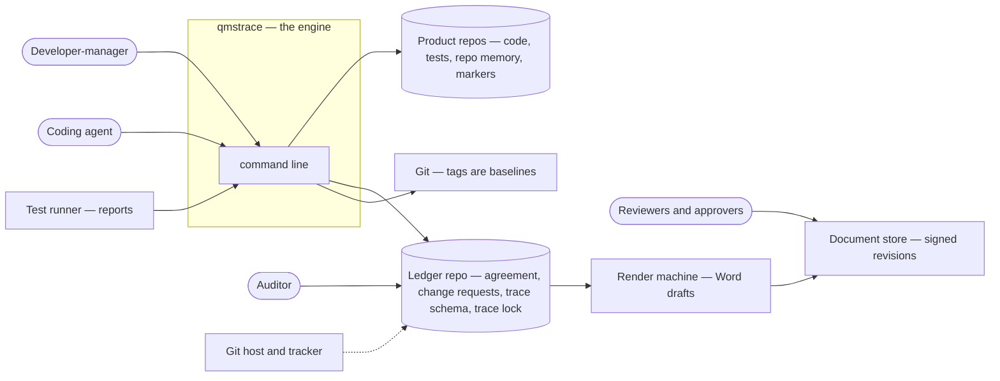
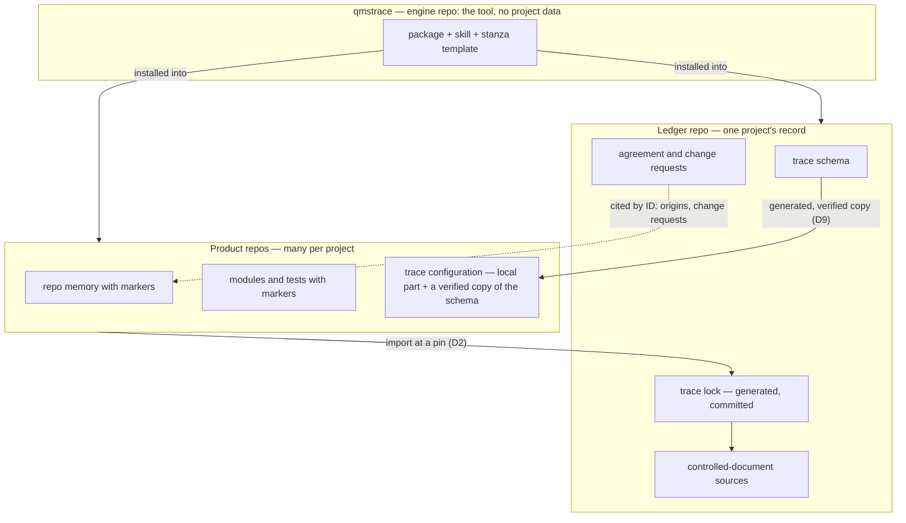
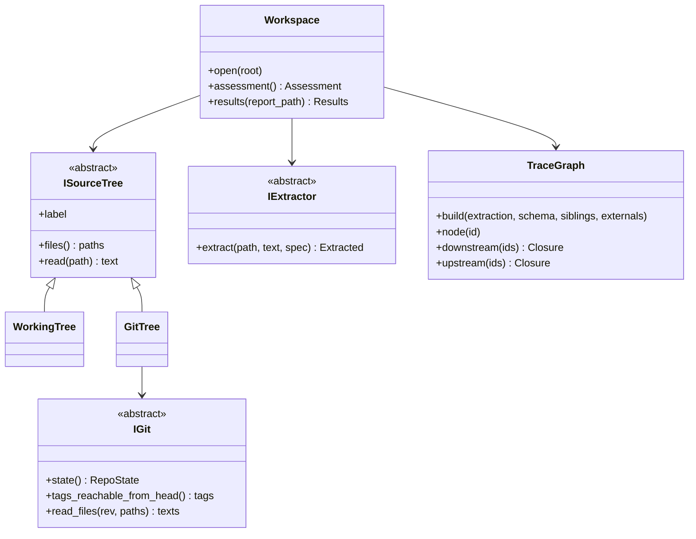
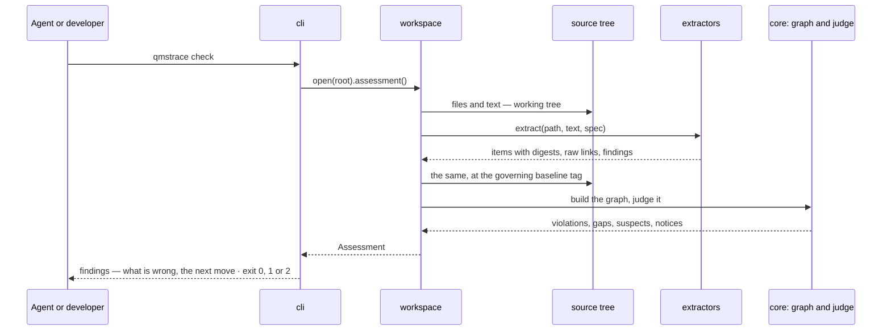

# qmstrace — System & OOP Architecture

> Source: the PRD, decisions D1–D10, the surface architecture, the slice-1 tracker and four experiments on a test bed · Date: 2026-09-21 · Mode: Design · Type: Application (a command-line tool)
> See also: [Data Architecture](data-architecture.md) · [Surface Architecture](surface-architecture.md) · [Product Requirements](../req/qmstrace-prd.md) · [Progress tracker](../progress/overview-qmstrace.md)

Terms follow [`CONTEXT.md`](../../CONTEXT.md). **✔** marks what an experiment exercised,
**◻** what is planned.

## 1. Overview

qmstrace keeps the state, traceability and audit evidence of a software project's work
products, so that an auditor's questions are answered by query instead of by assembly. It is
**a tool installed into repositories that already exist** — it holds no project data, runs no
server, and owns no evidence: it reads markers where people and agents already write, judges
them, and points at evidence that stays in its home system.

**Type: application** — a single command-line entry point, `qmstrace`, with package data (a
skill, a stanza template) shipped beside the code. Nothing is meant to be imported.

**Stack:** Python 3.13+, `uv`, `typer`; the standard library for TOML, `ast` and globbing;
`defusedxml` for test reports. An in-memory DuckDB arrives with the ledger (slice 2).

## 2. System Context



| Outside the engine | What crosses the boundary | Status |
|---|---|---|
| **Product repos** | The engine reads markers and the trace configuration; `init` writes the configuration and a stanza. It never writes requirements, design or code | ✔ |
| **Ledger repo** | The engine reads the trace schema, the agreement and the change requests; the ledger group writes the trace lock | ✔ import (by the driver of an experiment) |
| **Git** | Tags are baselines; a tree at a revision is a source like any other | ✔ |
| **Test runner** | A report file comes in; verdicts are never typed | ✔ |
| **Render machine** | The engine emits tables as data; a predecessor's machinery turns them into Word drafts. The engine knows nothing about Word | ◻ |
| **Document store** | Reviewers read, edit and sign there. A signature becomes an event with an evidence pointer — how, is open | ◻ |
| **Git host and tracker** | Collectors harvest facts — reviews, merges, states — with the home system's own timestamps | ◻ |

Two launch sites, one per hat: the **product repo**, daily, for the standard's
software-implementation process; the **ledger repo**, occasionally, for its
project-management process (D5).

## 3. High-Level Structure

Three kinds of repository, and what moves between them:



| Where | Responsibility |
|---|---|
| **Engine repo** | The tool and what ships with it. Fixtures are a hand-made miniature — never a real project |
| **Product repo** | Requirements, design elements, modules and tests, each declared where it is written, links at the downstream end (D1). Its check is local and fast; what it reads from a sibling is *not pinned* and says so |
| **Ledger repo** | What belongs to the project and to no product repo: the agreement, change requests, the trace schema, the union of all repos at pins, the documents generated from it |

## 4. Components

The engine's package for slice 1. The decisive seam is **the source tree**, not Git: one scan
runs over a working tree, a tree at a baseline tag, or a sibling.

```mermaid
flowchart TD
    cli["cli — wiring only; maps outcomes to exit codes"]
    ws["workspace — Workspace.open(root).assessment()"]
    subgraph core["core — pure, no IO"]
        config["config — parse, validate, merge, provenance"]
        graph["graph — TraceGraph; an illegal link never enters"]
        judge["judge — coverage, baselines, guard, suspects"]
        find["findings — the catalogue: what is wrong, the next move"]
    end
    subgraph extract["extract — IExtractor takes text"]
        md["markdown"]
        py["python module"]
        pt["pytest + the report reader"]
    end
    subgraph infra["infra"]
        tree["ISourceTree — working tree · tree at a revision"]
        igit["IGit — state, reachable tags, files and text at a revision"]
        ext["externals — agreement, change requests, siblings"]
    end
    render["render — functions returning text"]
    cli --> ws
    ws --> config
    ws --> tree
    tree --> igit
    ws --> extract
    ws --> graph
    ws --> judge
    ws --> ext
    judge --> find
    cli --> render
```

`core` imports nothing from `infra` or `extract`. A command is *open → render → exit*; the
assessment is computed once and every renderer reads it.

M5a reads reachable local Git tags and immutable trees without checkout changes or network
fetching. The workspace resolves and scans historical configuration, then passes frozen values
to the pure baseline/change guard. `infra/externals` reads request files;
`extract/change_requests` parses their metadata. Historical schemas are pinned to the same
Git tree, while the request register is explicitly read from its current working tree.
The output distinguishes those evidence boundaries and never claims remote-tag completeness.

## 5. OOP & Class Architecture

A sketch — the object model is the blueprint's job (`docs/structure/`).



- **Interfaces only where something really varies**: the tree (two now, a pin in slice 2),
  the extractor (three now, another test framework later), Git (a real one; a scrubbed
  environment in tests). No repository pattern, no composition root — the Modular tier.
- **Judgement is pure functions**, not a class: `coverage`, `resolve_baselines`, `guard`,
  `suspects`, and the results matcher/aggregator. None touches Git or a file.
- **`Closure`** keeps the edge that reached each node, so `thread`, `impact` and suspects are
  three renderers of one traversal.
- **Value objects are frozen dataclasses.** A finding is data — code, file, line, item, what
  is wrong, the next move — and the line an agent reads is one renderer of it.

## 6. Key Flows

### A check in a product repo ✔ (as the stand-in ran it) → ◻ (as the engine will)



### One pytest report against the working tree — M4

The CLI resolves `REPORT` from the effective invocation directory. `Workspace.results`
reads it explicitly, even outside the Git-filtered tree, and passes bytes to the pure safe
JUnit reader. It builds one assessment, derives default report identities through the pytest
extractor's convention, then calls `core.results.summarize`. The returned frozen view contains
matched runs, unmatched identities and direct-link verdicts; the text renderer makes no
aggregation decisions. Sibling node fields retain inspection/analysis methods, but only local
tests contribute. No result is written back and no report commit is verified. Usable partial
or failed results exit 0; unusable reports and zero matches exit 2.

### A project judged as a whole ◻ (slice 2; run once by hand in the fourth experiment)

```mermaid
sequenceDiagram
    participant M as Project side
    participant L as qmstrace ledger import
    participant P as Product repos
    participant K as trace lock
    M->>L: import gateway@tag agent@tag
    L->>P: read each repo at its pin — never a working tree
    L->>L: union · authored IDs unique · derived IDs qualified by repo
    L->>L: verify each repo's copy of the schema; judge across repos
    L->>K: write — sorted, byte-identical on a second run
    K-->>M: the diff a reviewer reads
```

## 7. Extension Points

The accepted [M7b local trace browser](trace-browser.md) adds a presentation-data projection
and an offline HTML renderer over one workspace assessment. Judgment stays in the core;
browser code handles layout and interaction, with traversal parity against the core.
There is no server or stored review state. Historical suspect reasons are displayed without
joining graph versions. Project-wide browser data awaits the ledger's import at pins.
An embedded renderer library is provisional until fixture evaluation.

M5b extends the existing assessment: workspace builds and caches each historical local graph
under its tagged schema, without reading external historical dependencies. Pure suspect
judgment combines independent walks from that graph and the current graph, retaining each
root's snapshot and per-version distances. Structured suspects live in the assessment;
renderers format the compact status view and complete check findings. Suspects do not enter
the failure predicate or persist review state.

Configuration before code: **item types, ID patterns, link types and coverage rules are data**
in the trace schema, and a **profile** is data too — a second standard needs no engine
change (PRD goal 6). In code, the one planned extension is **an extractor** — another test
framework, another document format — behind `IExtractor`, named per item type in the
configuration. Collectors (slice 3 and after) will be the second. There is no plugin system
and none is planned until two extractors exist outside this repo.

## 8. Key Abstractions / Glossary

[`CONTEXT.md`](../../CONTEXT.md) is the glossary. The few a newcomer needs first: **item**,
**link**, **marker**, **trace schema** and **trace configuration**, **baseline** and
**frozen**, **change request**, **suspect**, **ledger** and **trace lock**, **pin**.

## 9. Decisions needed

None new here. The gate's stage-awareness remains ledger work; quiet output and withdrawal
are settled in [Surface Architecture](surface-architecture.md) and D7. The persisted format
of a test function's digest remains in the [progress tracker](../progress/overview-qmstrace.md);
the ledger half — events,
work-product states, the signature loop — in [Data Architecture § Not yet
written](data-architecture.md).


## Setup and local browser (M6/M7b)

`init` writes explicit managed product-repo files through infrastructure, preserving authored
configuration and unrelated guide/settings text. Its packaged skill and stanza arrive with
the wheel. The offline browser is another renderer of one assessment: Python supplies
validated current links, precomputed reach and findings; embedded JavaScript supplies
layout and controls. The HTML is a disposable working-tree snapshot, with no server,
source edits, network collection or review persistence. The pinned browser library is
package data; Node.js is needed only for development control tests.
