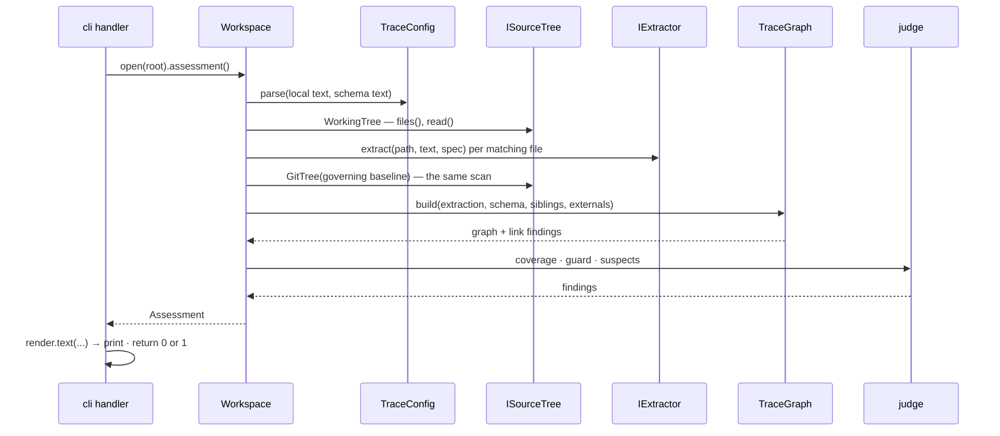

# qmstrace — Codebase Blueprint (slice 1)

> Inputs: [Product Requirements](../req/qmstrace-prd.md) · [Data Architecture](../design/data-architecture.md) · [Surface Architecture](../design/surface-architecture.md) · [System Architecture](../design/system-architecture.md) · [Progress tracker](../progress/overview-qmstrace.md) · [Scenario catalogue](../tests/scenario-catalogue.md) · the framework as installed: Typer 0.27.2, `uv_build`, Python 3.13 · Date: 2026-09-21

The design docs are this document's input, and it has standing to amend them. **The findings
are the value**; the tree and the types are the forcing function that produced them.

## 1. Findings — where two documents, or a document and the framework, could not both be true

Verified by running code where it says so.

| # | What collided | Resolution |
|---|---|---|
| F1 | **Surface doc's exit codes × the framework.** `2` = violations, `3` = usage. The framework exits `2` on a usage error and `1` on an abort or an uncaught exception *(verified)* | `0` no failing findings · `1` the check failed · `2` could not judge · `3` internal error. Surface doc amended |
| F2 | **The plan's `main()` × Typer 0.27.** The plan caught the click library's exceptions to map exit codes. This Typer vendors click privately and the `click` package is not installed at all *(verified: `import click` fails)* | Never import click. Typer owns usage errors; a decorator on each handler maps *our* outcomes — returned int, `CouldNotJudge` → 2, anything else → 3 *(verified: all six cases)* |
| F3 | **D9's embedded copy × TOML.** Schema and configuration both declare `[items.requirement]`; a TOML parser refuses a table declared twice *(verified)* | The copy lives under its own `[schema]` namespace. D9 amended |
| F4 | **D9's copy × ledger-relative paths.** With the schema copied, the paths to the agreement and the change requests no longer resolve | An optional local `ledger` pointer; without it, external sources are *not verified* |
| F5 | **D6's subject scope × the configurations.** A baseline freezes a subject; no configuration named one | `[subjects.<name>] key = …`; the stanza names the subject |
| F6 | **PRD success criterion 4 × dispatch by type name.** "A second trace schema needs no engine change" — the stand-in parsed an item type as tests only if it was literally called `test_case` | The extractor is named per item type in the configuration |
| F7 | **D6 "reachable from `HEAD`" × a pipeline's default checkout** — shallow, no tags. The guard would be off while the gate passes | With baselines configured, known incomplete history is *could not judge*. M5a states the offline limit: remote-tag completeness cannot be inferred from local refs |
| F8 | **D7 "never clears by being touched" × the stand-in**, which tracked test cases by file and cleared a suspect when its item was edited | Item-level digests for every item type; the suspect rule written out in D7 |
| F9 | **The stand-in's two glob matchers × each other** — they disagree on `src/**/*.py` *(verified)* | One matcher from the standard library, for every tree. Python 3.13 |
| F10 | **D4's in-memory database × a check that runs fifteen times a session** over a few hundred items | The database arrives with the ledger. The guarantee is kept by construction: an illegal link never enters the graph. D4 amended |
| F11 | **Verb → action → field.** Every verb the surface doc promises was walked to a use case and a field. `impact` had no reference behaviour; `init` did not say how it registers the test framework's marker; `results` did not list inspection-verified requirements apart; `thread` did not label its edges | Each is now specified in the scenario catalogue. The `ledger` verbs land nowhere in slice 1 — they are parked, and the surface doc marks them planned |
| F12 | **Package data × the build backend.** A skill and templates must ship inside the wheel | `uv_build` includes files under the package directory *(verified: a wheel was built and the asset found in it)*. Milestone M1 repeats this in CI |
| F13 | **D4's database "where the union of several repos is queried" × the ledger's check (M10a)**, which queries exactly that union over working trees | The union is the repos' graphs joined (`TraceGraph.join`) and judged by the same pure functions; no database. D4 stays the slice-2 intent — for a ledger that holds state and emits tables *(verified: the split fixture and the old layout are judged whole, `tests/integration/test_project.py`)* |

## 2. Forks — where each was settled

| Fork | Settled | Where |
|---|---|---|
| **Use-case ownership** | `Workspace.assessment()` sequences *scan → graph → judge* once and holds nothing mutable; a command renders the result. No use-case object per command | slice tracker § Module shape |
| **Failure model** | A problem in the *user's repo* is a **finding — data, never an exception**; extractors return findings, they do not raise. An inability to judge is one exception, `CouldNotJudge`, carrying the next move. Anything else is an internal error. The user sees exit `0 / 1 / 2 / 3` | F1, F2 |
| **Boundary thickness** | Typer's types stay in `cli/`. A handler takes plain values and returns an int; `core` never sees the framework | developer's survey of existing CLIs; F2 |
| **Wiring and substitution** | `Workspace.open(root, *, git=None)` — a test passes its own tree or Git; extractors are looked up by the name the configuration gives. No container, no composition root | Modular tier, chosen by the developer |
| **Tree axis** | By layer | Modular tier |
| **Concurrency** | Not applicable — a single-threaded command-line tool | — |
| **Prescriptiveness** | 💡 **Conceptual.** Signatures here are sketches; the invariants table carries what is worth enforcing. Pinned signatures rot at the first refactor | this document's judgement |

## 3. The tree

```
src/qmstrace/
  __init__.py            the version, read from package metadata — nothing else
  cli/                   Typer wiring; installed entry point stays qmstrace.cli:app
    __init__.py          exact compatibility exports of the 22 existing public names
    _app.py              root app, callback/version and explicit root-command registration
    _local.py            eight local handlers: arguments → workspace → render → exit code
    _ledger.py           ledger sub-app and its five handlers
    _options.py          Directory annotation and duplicate -C reconciliation
    _outcome.py          exit constants/help and outcome decorator; errors on stderr
  workspace/             orchestration; callers keep importing qmstrace.workspace.Workspace
    __init__.py          exact exports: Workspace, TreeFactory, CONFIG_FILE, SCHEMA_FILE
    _workspace.py        public class; local assessment, thread/impact and explicit report reading
    _discovery.py        roots, ledger location, configuration loading and path semantics
    _scanning.py         one scanner and _Scan; text cache, file selection, misplaced declarations
    _sources.py          sibling items, external declarations and change-request register
    _baselines.py        historical snapshots and calls to pure baseline resolution/guards
    _project.py          project member validation, qualified items, graph union and assessment
    _setup.py            init and schema-copy orchestration; transactional writes via infra/files
  core/                  pure — no file, no Git, no framework
    errors.py            CouldNotJudge — the one way a run says it could not judge; carries the next move
    model.py             Item, Link, Lead, Mention, Stray, Finding, Notice, Extracted — frozen dataclasses;
                         ID_TOKEN, what reads as an ID at all; text_digest — item text, digested;
                         Extracted.qualified — an extraction as the whole project sees it (M10a)
    config/              pure configuration package; callers keep importing qmstrace.core.config
      __init__.py        explicit compatibility exports only
      _schema.py         configuration records and extractor capabilities
      _toml.py           strict table reading, types, versions and unknown-key diagnostics
      _sections.py       schema/local section readers and ID-prefix policy
      _copy.py           schema digest and TOML-aware copy-marker recognition; shared with setup
      _parse.py          TraceConfig constructors, schema forms, assembly and cross-checks
    graph/               pure graph package; callers keep importing qmstrace.core.graph
      __init__.py        explicit compatibility exports only
      _nodes.py          Home, Node, Surroundings — node ownership and visible boundary evidence
      _validation.py     schema admission: targets, fields, malformed declarations and mentions
      _graph.py          TraceGraph.build/join with shared private assembly, queries, walks -> Closure;
                         Direction, Step, Closure — distance, parent and alternate links
    judge/               independent pure policies; callers keep importing qmstrace.core.judge
      __init__.py        explicit compatibility exports only
      _coverage.py       Form, coverage and gap next moves
      _baselines.py      resolve_baselines, guard — ancestry, ownership and fresh citations
      _suspects.py       suspects — per-root historical/current reach and edit evidence
    baselines.py         frozen tag evidence, historical snapshots, request register and item
                         comparisons (M5a), suspect values and per-root reasons (M5b); no IO
    results.py           frozen report/result values; pure exact matching, run deduplication and
                         direct-verifies verdict aggregation (M4)
    tables.py            the ledger's tables — matrix, requirements register, coverage summary —
                         as columns and rows derived from the schema's chain (#49, ADR-0005)
    setup/               pure setup edits; callers keep importing qmstrace.core.setup
      __init__.py        explicit compatibility exports only
      _guide.py          stanza, guide block replacement and authoring-skill installation paths
      _pytest.py         pytest section detection and marker registration
      _schema_copy.py    Held, Copied, schema inspection, block generation and proven replacement
    findings.py          the catalogue: each code once — what is wrong, the next move
    assessment.py        Assessment: violations, gaps, suspects, notices, frozen state, what was scanned;
                         ProjectAssessment and RepoState — the ledger's check (M10a); Checkout,
                         each repo's commit and cleanliness as a table records it (#49)
  extract/               text in, items out — never a path, never a repo
    base.py              IExtractor, the registry by name; FORMS — how each extractor's items
                         write a link, for a gap's next move (M3)
    fields.py            the field line `Key: value` — shared by every extractor that reads fields
    markdown/            text extraction; callers keep importing qmstrace.extract.markdown
      __init__.py        explicit exports of extract, form and CHANGE only
      _extract.py        section state, fields, fences/frontmatter, findings, mentions and item text
      _headings.py       decorated IDs, heading values, normalized titles and item-shaped boundaries
      _tables.py         cells, delimiter rows, cell decoration and misplaced table markers
    python/              language-specific owners, independent of one another
      __init__.py        empty; callers import the concrete owner
      module.py          module components, docstring markers, strays and syntax-tree digest
      pytest_tests.py    test collection, verifies markers, digest and report_identity(node_id)
    csharp/              C# (ADR-0004): independent owners over one private parser
      __init__.py        empty; callers import the concrete owner
      _syntax.py         the only tree-sitter importer: types, methods, attributes, comments
      component.py       csharp-file — a .cs file, its first type's /// field lines, strays
      xunit.py           xunit — [Fact]/[Theory] methods, the DisplayName's ID, run identities
    python_module.py     compatibility imports of python.module extract and form only
    pytest_tests.py      compatibility imports of python.pytest_tests extract, form, report_identity
    reports.py           bytes -> Report: one safe defusedxml parse; the root picks the reader
    junit.py             pytest JUnit XML root -> Report entries; no summary count trusted
    trx.py               TRX root -> Report entries by class and method; no path, name or output
    change_requests.py   request text preamble -> metadata or diagnostic; no IO, no approval
                         inferred from examples or prose
  infra/                 everything that touches the world
    tree.py              ISourceTree · WorkingTree — files(), read(), label · GitTree (M5a)
    git.py               the one subprocess helper, run where it asks, redirects scrubbed ·
                         working_files() · checkout(), the commit and a clean tree, read without the
                         index lock (#49) · IGit, GitCli — reachable tags, files at a revision (M5a)
    externals.py         raw change-request directory reads (M5a). The agreement and siblings need
                         no module: they are read as WorkingTrees
    globbing.py          the one matcher, for every tree
    files.py             contained setup writes with rollback, across several repos as one
                         change (M9b); a create-only Link in that change (M9c); exclusive view
                         output (M6/M7b)
  render/
    _presentation.py     shared item labels, finding lines and pluralized counts
    _evidence.py         source/sibling/baseline evidence, shared by text views and the browser
    text/                command views; callers keep importing qmstrace.render.text
      __init__.py        eleven functions and six constants, direct compatibility exports only
      _status.py         scan inventory, requirement rows, categories and compact suspect summary
      _walks.py          thread/impact and ledger variants; shared walk presentation
      _checks.py         check/ledger_check, complete findings, quiet notices and result lines
      _results.py        report verdicts, shared tests and nonpassing run details
      _schema.py         rules, schema descriptions and schema-copy outcomes
    graph.py             deterministic assessment projection and standalone HTML (M7b)
    tables.py            one table as a qmstrace.table/1 JSON document, deterministic (#49)
  assets/                skill/SKILL.md · stanza.md · starter.toml + items-python/csharp.toml (#38) · ledger-starter.toml (M10c) · graph.html/js · pinned
                         vendor/vis-network and license — package data
tests/
  browser/               Node built-in tests for display-only control behavior; no npm deps
  unit/                  core and extract, on text — no Git, no disk
  integration/           real Git in tmp_path, a scrubbed environment, session-scoped templates
  cli/                   CliRunner against golden text files
  fixtures/mini/         the hand-made miniature project, plain files
  fixtures/split/        the same project in the layout of ADR-0001 — a traced ledger holding the
                         documents, product repos holding code and tests (M10·0)
  conftest.py            project (the fixture project as real Git repos) · split (fixtures/split,
                         likewise) · alone (one repo as a pipeline checks it out) · make_repo ·
                         git_env (a scrubbed environment)
  meta/                  tests of the tool's own rules — a test's level is its folder here
    test_architecture.py the import matrix, enforced
    test_assets.py       package data is readable from the installed package
    test_catalogue.py    every command has a golden; every code has a fixture that emits it
    test_manual.py       the user manual: a page per command, a TL;DR per page, every page in
                         nav, includes only from tests/; the findings-table golden
    test_skill_parity.py every marker example in the skill parses; every code has catalogue text
  cli/golden/            command output and help — the goldens the manual includes
  manual/findings.md     the findings table, rendered from core/findings.py
```

Beside the package: `contents/` — the user manual, built by Zensical from `zensical.toml` and
published by Netlify from `netlify.toml` ([writing it](../dev/writing-the-manual.md)). It imports
nothing from the package: it includes files that tests own.

`workspace/` and `cli/` sit at the package's top level. Workspace orchestration imports
core, extraction and infrastructure; CLI wiring imports the workspace and renderers. The
workspace package never imports rendering or CLI code.

## 4. Seams

| Seam | Why it is real | Varies today | Later |
|---|---|---|---|
| `ISourceTree` | The same scan reads "now", "at a baseline tag" and a sibling | working tree · tree at a revision | a pin, at the ledger's import |
| `IExtractor` | One per source type, named in the configuration | Markdown · Python module · pytest | another test framework |
| `IGit` | Git's own semantics are the risk — reachability, annotated tags, shallow clones | the command-line client | — tests use a **real** Git in a scrubbed environment, not a fake |

`IGit` has one implementation and is still an interface: it is domain-shaped — *reachable
tags*, *files at a revision* — so `core` and `workspace` never see a subprocess, and a unit
test of `workspace` can hand in a stub tree without Git at all.

## 5. A run, at object granularity



`CouldNotJudge` may be raised by `config`, `tree` or `git`, by pure baseline resolution when
ancestry or subject ownership is ambiguous, and by `workspace` while it finds the
repo and reads its configuration — nowhere else; `@outcome` turns it into exit `2` with its next
move. A sibling that cannot be judged is not this repo's failure: `workspace` turns it into what
the header says about that sibling.

## 6. The import matrix

Rows may import columns. Enforced by `tests/meta/test_architecture.py`, which walks each module's
`ast` — the pattern the developer's own tools already use — so it needs no new dependency.

|  | core | extract | infra | render | workspace | cli | typer | stdlib |
|---|---|---|---|---|---|---|---|---|
| **core** | ✔ | — | — | — | — | — | — | ✔ |
| **extract** | ✔ | ✔ | — | — | — | — | — | ✔ |
| **infra** | ✔ | — | ✔ | — | — | — | — | ✔ |
| **render** | ✔ | — | — | ✔ | — | — | — | ✔ |
| **workspace** | ✔ | ✔ | ✔ | — | ✔ | — | — | ✔ |
| **cli** | ✔ | — | — | ✔ | ✔ | ✔ | ✔ | ✔ |

`extract` also imports `defusedxml`, in `reports.py` only, and `tree_sitter` with
`tree_sitter_c_sharp`, in `csharp/_syntax.py` only (ADR-0004); a test pins each. Nothing imports
`click`.

Within `core/judge`, coverage, baseline guards and suspects are independent policies; they
share the public graph, configuration and evidence values without importing one another.
Within `core/graph`, `_graph` imports `_validation` and `_nodes`; `_validation` imports
`_nodes`; `_nodes` imports only the extracted model. `findings.py` keeps its suspect import
under `TYPE_CHECKING`, preventing a runtime graph → findings → baselines → graph cycle.
Within `core/setup`, `_guide`, `_pytest` and `_schema_copy` do not import one another.
Guide and schema-copy policy use public configuration imports; pytest editing needs only
`CouldNotJudge`. All three perform pure text transformations; their constants and records
stay beside the policy that owns them. The architecture and distribution gates check these
boundaries, exact compatibility exports and import orders.

Within `extract/markdown`, `_extract` owns the section loop and imports `_headings` and
`_tables`; those syntax owners never import one another or the extraction state. Heading
values and regular expressions stay with their owner. Fence state and frontmatter remain
beside item assembly because fence lines contribute to digests while declaring nothing.
`fields.py` remains shared with Python and request extraction; their parsing contracts are
not unified. Public `extract`, `form` and `CHANGE` imports forward their original objects.
Splitting section state into additional handlers was rejected: it would scatter the ordering
that governs fields, mentions, section boundaries and digest text without simplifying callers.

Within `extract/python`, `module.py` and `pytest_tests.py` own independent language/framework
policies. Neither imports the other, the registry, the workspace or a compatibility module;
neither imports pytest at runtime. Both retain their own short syntax-error conversion.
A shared Python parser helper is deferred until there is shared policy beyond that small
block. `base.py` registers these concrete owners under the unchanged `python-module` and
`pytest` names. The old `extract/python_module.py` and `extract/pytest_tests.py` files only
forward their supported functions, without wrappers; production callers use the canonical
owners. `python/__init__.py` remains empty. Architecture and wheel gates pin these boundaries.

Language packages sit side by side — `python/`, and `csharp/` since M12d — each implementing
`IExtractor` under explicit names; language dispatch by extension and a generic language base
class are not introduced. Component granularity, marker syntax and test-framework identities
are chosen per language: for C#, a component is a file and an xUnit test's report identity is
its namespace-qualified class and method (ADR-0004). A test extractor records each item's run
identities (`Item.runs_as`), so `results` matches any language's tests without importing it;
reading a report format stays outside the language packages.

Within `render/text`, command owners do not import one another or the compatibility facade.
They import `_evidence` and `_presentation` from `render/` when needed. Shared evidence
imports presentation helpers; presentation imports only core values. `render/graph.py` reads
`evidence` directly from the shared owner, while `render.text.evidence` remains a direct
compatibility export. Eleven public functions and six public constants retain their imports.
Local and ledger variants stay together in `_walks` and `_checks`: splitting by repository
scope would separate existing shared formatting. Constants and single-view helpers remain
with their owner; `_presentation` is limited to item labels, finding lines and noun counts.
The ownership move preserves output bytes, ordering, quiet-mode evidence and current
traversal/aggregation boundaries. It introduces neither a renderer class nor new judgment.

Within `workspace/`, `_workspace.py` retains the public frozen/slotted `Workspace`, local
assessment and command sequencing. `_project.py` owns the ledger's joined assessment and
member validation; `_setup.py` owns setup/copy orchestration. Both are private functions behind
the existing classmethods, not new service objects. Setup receives a configuration-loading
callback so `initialize` still dispatches through `cls.open`; project walks still call
`cls.project`. Local walks and results still call `self.assessment` once when needed.

Shared reading flows downward: `_project` uses `_sources`, `_baselines`, `_scanning` and
`_discovery`; `_sources` uses `_scanning` and `_discovery`; `_baselines` uses `_scanning` and
`_discovery`; `_setup` uses `_discovery`. `_scanning` and `_discovery` are independent.
No owner imports `_workspace` or the compatibility facade. The architecture gate checks
these imports, including type-only back edges, and callers use the public interface.

Discovery preserves displayed versus resolved paths and current versus historical schema
reads. Scanning retains per-scan text caching; historical snapshots retain per-commit reuse
within an assessment. No cross-run cache is introduced. Sibling unavailability, whole-project
refusal and historical-snapshot refusal keep their distinct policies and ordered diagnostics.
Setup still plans before transactional writes. Results still read and validate the report
before assessing the repository. Splitting each short command method or introducing mixins
was rejected: the opened workspace already owns their shared assessment lifecycle.

Within `cli/`, `_app` owns root construction, callback/version and explicit registration in
existing command order; it imports `_local`, `_ledger`, `_options` and `_outcome`. `_ledger`
owns its own sub-app and registration. Local and ledger handlers import shared options/outcome
policy, public workspace operations and renderers; they never import one another or `_app`.
The shared policy modules are independent and never import workspace, renderers or handlers.

`qmstrace.cli:app` remains the installed entry point. The facade forwards all 22 defined
public names, including both apps, handlers, `Directory`, `outcome` and exit constants.
Handlers retain signatures, postponed annotations, docstrings and the `functools.wraps`
chain that Typer inspects. Registration metadata, help bytes, eager version handling,
no-argument help, stdout/stderr separation and existing `-C` placements are preserved.
Report/output path resolution stays in the handler. A command factory, dynamic discovery and
one module per short handler were rejected: they add machinery without a distinct owner.
Architecture and wheel gates pin dependencies, export identity and command construction.

M4's report boundary is not an item extractor and is not registered in `IExtractor`.
`Workspace.results` reads explicitly supplied bytes (outside the Git-filtered tree), converts
parse diagnostics and zero matches to `CouldNotJudge`, obtains identities from
`python.pytest_tests.report_identity`, then calls `core.results.summarize`. The CLI resolves the
report path before opening the workspace. Matching and aggregation stay in core; the renderer
only presents frozen values. Graph nodes retain authored fields for sibling verification
methods without making sibling nodes local items. No pytest runtime import is needed.
`types-defusedxml` is a development dependency for strict mypy; runtime dependencies are unchanged.

M5a adds optional `git=` injection to `Workspace.open`, a domain-shaped `IGit` implemented by
`GitCli`, and `GitTree`. Reads resolve to immutable commits; Git redirects are scrubbed and
lazy object fetching is disabled. The workspace first selects scope candidates from ancestry,
then caches selected historical snapshots by commit and reuses the scanner. Historical scans
never recurse into sibling assessments or baseline resolution. The historical configuration
and any referenced schema must come from that Git tree; the current ledger is not a fallback.
`Assessment.baseline_state` contains tags, comparisons and request availability. Rendering
derives labelled counts from those comparisons; judgment remains in `core/judge/_baselines.py`.
M5a and M5b add no configuration keys or dependencies. Suspect traversal reuses these snapshots.


## 7. Where a change lands

M5b's frozen `Suspect` and `SuspectReason` values live alongside baseline comparisons in
`core/baselines.py`; snapshots retain their validated local graph. `core/judge/_suspects.py` computes
per-root reach and digest comparisons without IO. Workspace scans a tagged tree once per
commit and never completes it from current external files. Assessment carries the complete
suspect list; renderers format status summaries and the catalogue's S01 text without
deciding eligibility. The check failure predicate remains violations plus strict gaps.

| Asked to… | The one file |
|---|---|
| reword a finding, or change its next move | `core/findings.py` — a gap's wording too; its code and text are the schema's |
| change how a marker is written in a next move | the extractor's `form()` — `tests/unit/test_forms.py` round-trips it |
| add a finding code | `core/findings.py`, the owning policy in `core/judge/` or admission check in `core/graph/`, a `SCENARIOS` entry in `test_catalogue.py` — which fails until all three exist — and a line in `broken()` for the wording review |
| add a coverage rule | no code — the trace schema |
| read a new marker form, or another test framework | one new file in `extract/`, registered by name |
| change what counts as an item's text | `extract/markdown/_extract.py` — and data architecture § Item text, because it moves digests; the pinned fixture digests in `test_extract_markdown.py` say which |
| change which headings declare, or where an item ends | `extract/markdown/_headings.py` (syntax) and `_extract.py` (section state) — and § Marker syntax v0 |
| change how a baseline is chosen | `core/judge/_baselines.py` `resolve_baselines` |
| change what Git is asked | `infra/git.py` |
| change how the project's schema is copied into a repo | `core/setup/_schema_copy.py` `schema_block`, `held_schema`, `copy_schema` — `tests/unit/test_schema_copy.py`; which repos and refusals: `workspace/_setup.py` `copy_schema` |
| add a verb to a group (`ledger …`) | `cli/_ledger.py` (the group's sub-app), `render/text/`, goldens `<group>-<verb>-*.txt` and `help-<group>-<verb>.txt`, and the verb's help included in the group's page — the meta-tests fail without them |
| add a table, or change a table's columns or rows | `core/tables.py` (derivation, from the schema) and `render/tables.py` (the document); goldens `ledger-table-*.json`; [the table format](../../contents/reference/table-format.md). A change that is not additive is `qmstrace.table/2` (ADR-0005) |
| change a command's output | the owning view in `render/text/` and its golden file — then `rg <golden> contents/` for the prose that frames it |
| change which items a walk reaches, or in what order | `core/graph/_graph.py` `_walk` — `thread`, `impact` and suspects all render it; `tests/unit/test_graph.py` § walks pins the rules |
| add a command | `cli/_local.py` (handler) and `_app.py` (registration and `short_help`), `render/text/`, goldens for its output and its help, a page in `contents/reference/commands/` — `test_catalogue.py`, `test_help.py` and `test_manual.py` fail without them |
| change a configuration key | `core/config/_sections.py` (section policy), `_schema.py` (records), `_parse.py` (assembly/cross-checks), both test-bed configurations, the `init` starter and its `items-<language>` fragments |
| change what the agent is told | `assets/skill/SKILL.md` or `assets/stanza.md` — `test_skill_parity.py` guards the examples |
| change which repos the ledger's check reads, or when it refuses | `workspace/_project.py` `_members` — `tests/integration/test_project.py` § refused |
| change how a derived ID or a location is written for the whole project | `core/model.py` `Extracted.qualified` — and the trace lock's future `(ID, type, repo, file, digest)` line |
| change how the repos' graphs are joined | `core/graph/_graph.py` `TraceGraph.join` — `tests/unit/test_graph.py` § the project's graph |
| change when a dependant in another repo is suspect | `core/judge/_suspects.py` `suspects` — `tests/unit/test_suspects.py` § across repos, and data architecture § D7 |

## 8. What is deliberately absent

- **No `Judge` class.** It would hold no state; four pure functions are deeper than one object
  with four methods and a constructor.
- **No repository pattern, no service layer, no composition root.** The Modular tier earns
  none of them; `Workspace` remains the public sequencer, with private orchestration owners
  in its package.
- **No renderer interface.** There is one renderer. It becomes an interface the day a second
  form exists, and findings are already data so that day is cheap.
- **No fake Git.** A fake would encode assumptions about exactly the semantics under test.
- **No database.** Until the ledger. The ledger's check (M10a) queries the union of several
  repos without one: the same pure functions judge the joined graph (F13).
- **No `Ledger` class.** `ledger copy-schema` and the ledger's check (`Workspace.project`) are
  classmethods on `Workspace`, like `init`; the check's result is a value
  (`ProjectAssessment`), not an object. A ledger-side object waits for the import, when the
  ledger holds state of its own.
- **No plugin system.** Extractors are a registry by name inside the package until two exist
  outside it.
- **No `utils.py`, no general barrel re-exports.** `__init__.py` files are empty but for the
  package version and the explicit compatibility exports in `core/config/`, `core/judge/`,
  `core/graph/`, `core/setup/`, `extract/markdown/`, `render/text/`, `workspace/` and `cli/`. Those
  exceptions forward the original objects; they contain no wrappers or initialization logic. Internal modules import their
  owners directly, never the compatibility facade. The architecture gate checks nested
  initializers, exact exports, each package's dependency direction and callers' public imports.
  The two legacy Python extractor modules also permit only exact forwarding imports;
  `extract/python/__init__.py` stays empty and canonical callers import its concrete owners.
- **No pydantic, no rich.** Dataclasses and plain text; the tool installs with Typer,
  `defusedxml` and, for C#, tree-sitter with its C# grammar (prebuilt wheels; ADR-0004).
- **No use of the framework's private modules.** Typer's vendored click is not ours to import.
- **No second item type named in `status`.** It lists `requirement` items and reads `Category`
  and `Verify-by` by name — a known hard-coding in `render/text/_status.py`, since every trace schema so
  far uses those names. `core/judge/_coverage.py` owns rule applicability and the shared
  test-backed display classification used by status and results; rendering only arranges the
  classified values. Everything else it prints comes from the configuration. Revisit when a
  second schema does not.

## 9. Invariants

★ = a test or tool checks it.

| Invariant | Checked by |
|---|---|
| ★ `core` imports only `core` and the standard library; nothing imports `click` | `test_architecture.py` |
| ★ Every registered command has a golden output | `test_catalogue.py` |
| ★ Every finding code has catalogue text and a fixture that emits it | `test_catalogue.py` |
| ★ Every command has a help golden and a reference page in the user manual | `tests/cli/test_help.py`, `test_manual.py` |
| ★ Every manual page opens with a TL;DR and is in the navigation | `test_manual.py` |
| ★ The manual includes only goldens and fixtures under `tests/`, and a missing one fails the build | `test_manual.py`; `pymdownx.snippets` `check_paths`; `just manual-build` (strict) |
| ★ Every marker example in the shipped skill parses with the real extractors | `test_skill_parity.py` |
| ★ Two runs of any command on the same tree give identical bytes | `tests/cli/` |
| ★ Exit codes: a usage error 2, `CouldNotJudge` 2, a raised exception 3, never a bare traceback | `tests/cli/test_exit_codes.py` |
| ★ An extractor takes text and never opens a file | `test_architecture.py` — nothing in `extract` imports a file-system module or calls `open`, `read_text` and their kin |
| ★ Every import is absolute, so the matrix cannot be walked around | `test_architecture.py`; ruff `TID252` |
| ★ The working tree is what a commit could carry — an ignored file is never read | `tests/integration/test_tree.py` |
| ★ The wheel contains the skill and the templates | CI, M1 |
| ★ An illegal link never enters the graph | `tests/unit/test_graph.py` — `build` returns it as a finding instead |
| ★ A walk reaches each item once, nearest first; forward crosses a link that counts toward no coverage, backward stops at it | `tests/unit/test_graph.py` § walks |
| ★ A sibling's item is a node but never this repo's own item | `tests/unit/test_graph.py`; the `status` goldens |
| ★ The ledger's check reads every repo in `[repos]`, or refuses and names each one it cannot | `tests/integration/test_project.py` § refused |
| ★ A derived ID is qualified by its repo in the project's graph; an authored ID never is | `tests/unit/test_model.py` § 4, `tests/integration/test_project.py` |
| ★ In the ledger's check, each repo's violations are the ones its own check reports when every sibling is read | `tests/integration/test_project.py` § 2 |
| ★ A suspect in another repo than its root's is reached by today's links only, and its edit state is never guessed | `tests/unit/test_suspects.py` § across repos |
| ★ Every marker form a gap suggests round-trips through the extractor that reads it | `tests/unit/test_forms.py` |
| ★ Gaps are judged on the judged items — this repo's, or in the ledger's check every repo's; `Assumes` counts toward none; a gap whose link was refused names the violation | `tests/unit/test_judge.py`, `tests/integration/test_project.py` |
| ★ Every finding, violation or gap, ends with a next move | `tests/meta/test_catalogue.py` |
| ★ A citation this run cannot verify passes as *not verified here*; an ID of this repo's own pattern never does | `tests/unit/test_graph.py`, `tests/integration/test_workspace.py` |
| ★ A suspect survives a touched file | `tests/integration/test_suspect_assessment.py` |
| ★ An item is its section: an edit under a sub-heading of a frozen item is a change | `tests/integration/test_baselines.py` |
| ★ A schema copy reads as the schema by path, keeps every other byte, and a second copy changes nothing | `tests/unit/test_schema_copy.py` |
| ★ The schema is copied into every named repo or none | `tests/integration/test_copy_into_repos.py`, `tests/integration/test_files.py` |
| ★ Setup never replaces what it did not write: a link is created or left alone, anything else at its path is refused before any write, and rollback removes a link it created | `tests/integration/test_files.py`, `tests/integration/test_setup_workspace.py` |
| ★ This repo's installed skill, its link and its stanza equal what the package ships | `tests/meta/test_own_trace.py` |
| ★ A group's every verb has an output golden, a help golden and its help on the group's page | `tests/meta/test_catalogue.py`, `tests/cli/test_help.py`, `tests/meta/test_manual.py` |
| ★ A marker in a form the extractor does not read is reported — a stray named by its gap, or V16 — never silently dropped | `tests/unit/test_forms.py`, `tests/unit/test_graph.py` |
| ★ An item with no sub-heading and no decorated heading keeps its title and digest across changes to the reading rules | `tests/unit/test_extract_markdown.py` § 7 |
| ★ A near-miss (V16) never stops a baseline tag's tree being read; every other violation does | `tests/integration/test_baselines.py` |
| A problem in the user's repo is a finding, never an exception | review; `extract/` has no `raise` outside parse failures it converts |
| `cli/` holds no business logic | review; its handlers are open → render → return |

## 10. Decisions that overrule a design doc

| This entry | Overrules | Marked there |
|---|---|---|
| F1 — exit codes | Surface Architecture § Interaction & State, first form | amended in place |
| F3, F4, F5, F6 — the configuration's shape | Data Architecture D9, first sketch; *The trace configuration* | amended in place |
| F7 — could not judge on a shallow clone | Data Architecture D6 | amended in place |
| F8 — the suspect rule | Data Architecture D7, first form | amended in place |
| F10 — the database arrives with the ledger | Data Architecture D4 | amended in place |
| F2 — never import click | the approved plan's `main()` sketch | slice tracker § Module shape |
| F13 — the union of several repos is judged without a database (M10a) | Data Architecture D4 ("the database earns its place where the union of several repos is queried") | noted here; D4 is left as the slice-2 intent, where the ledger holds state and emits tables |

All of these change **structure**. None removes a behaviour the surface doc promises.


## Setup and browser ownership (M6/M7b)

`Workspace.initialize` delegates to `workspace/_setup.py`, which reads package templates and
existing settings, plans every edit, then delegates writes to `infra/files.py`. `core/setup/` transforms strings without IO and
names the managed paths — the skill's home, the Claude Code link and its target (M9c).
`Workspace.initialize` decides whether the link is wanted; `infra/files.py` decides whether
its path is free.
The browser renderer may read immutable package assets through `importlib.resources`;
it never reads project files. `Workspace.save_view` owns the explicit exclusive output write.

`render/graph.py` projects the already-judged assessment and calls the shared forward/backward
walk for each visible item. Compact indexed reach arrays keep JavaScript limited to view
selection, depth/type/link filtering and layout. All-pairs reach can grow quadratically;
this is a deliberate local-view tradeoff, measured on 1,000 nodes, not a project-wide scale
promise. A larger future view must retain core parity if it changes this strategy.

Only validated current links enter the canvas. S01 text comes from the finding catalogue,
with complete historical provenance even when no current connection exists. JSON escapes
HTML delimiters and line separators, authored values enter the DOM through `textContent`,
and a document CSP denies connections. No source archive or runtime server is introduced.

## 11. Design elements — what the code is traced to

qmstrace is a product repo of its own project, `QMT`. Each section below is one design
element: the unit a module's docstring names with `Implements:` and a test names with
`pytest.mark.verifies`. It states what the unit does and which modules carry it; the
reasoning stays in the design doc it points to. The requirements are in the
[SRS](../req/qmstrace-srs.md). A module may implement more than one element; the tree in §3
remains the one line of ownership per file.

💡 The elements live here, in the structure doc, rather than as IDs on the decision headings
of the design docs (`D6 — …`): components implement a unit of the package, and the decision
sections span several units each and are linked to by anchor.

### DSN-QMT-01 — The command line: wiring only, and four exit codes

`cli/_local.py` and `_ledger.py` turn options into plain values, open the workspace, render
and return an int. `_app.py` registers the root commands and ledger group; `_options.py`
reconciles invocation paths. The public imports and installed `qmstrace.cli:app` entry point
stay unchanged. The `outcome` decorator in `_outcome.py` maps a returned int to its exit code,
`CouldNotJudge` (`core/errors.py`, carrying the next move) to 2, and anything else to 3 with one line and no traceback. The
framework's own usage error is already 2. Reasoning: §1 F1, F2; surface architecture § 5.

Satisfies: REQ-QMT-14

### DSN-QMT-02 — One workspace sequences a run

`Workspace.open(start)` walks up to the trace configuration and reads it;
`assessment()` scans the working tree once, reads the ledger's external sources and the
siblings, builds the graph, judges it, and returns one frozen `Assessment`
(`core/assessment.py`). A command renders that value and never computes on the way out.
The class lives in `workspace/_workspace.py`; discovery, scanning and surrounding-source
reads have private owners. Its constructor, injection points, public signatures and dispatch
remain unchanged. Project and setup methods delegate to their own orchestration modules;
judgment stays in core, transactions in infrastructure. What a run could not read or verify
becomes a notice in the assessment, never a silence.
Reasoning: §2 use-case ownership; §5.

Satisfies: REQ-QMT-03, REQ-QMT-05

### DSN-QMT-03 — The trace configuration is parsed and validated from text

`core/config/` parses the repo's trace configuration and the project's trace schema — by
path, as a schema copy checked against its digest, or the repo's own — into one validated
`TraceConfig` that records which part each rule came from. An unknown key, a pattern no ID
can match, an extractor that does not ship, two externals whose prefixes overlap (a citation
goes to the first one its ID starts with, #55) or an external `source` that is a pattern
rather than one file (#56) is refused with the next move. Reasoning: data architecture § D4,
D9; §1 F3–F6.

`TraceConfig` and assembly/cross-checks live in `_parse.py`; records in `_schema.py`;
strict TOML reading in `_toml.py`; section policy in `_sections.py`, backed by the conservative
shared-start proof in `_prefix.py`; digest and copy-marker
recognition in `_copy.py`. `qmstrace.core.config` preserves the previous imports. Dependencies
flow from parsing to sections/copy/records, and from sections to TOML/records; none returns
through the package facade. Constructor behavior, ordered results, digests and complete
refusal diagnostics are preserved. The package remains pure and introduces no dependencies.

Satisfies: REQ-QMT-01, REQ-QMT-04

### DSN-QMT-04 — Extractors read markers from text, chosen by configured name

`extract/base.py` registers an extractor per name the configuration gives an item type.
`markdown/` reads headings, sections and fields (`fields.py`), `python/module.py` the module
docstring's `Implements:` line, `python/pytest_tests.py` test functions and their `verifies`
decorators. Each takes text and never opens a file; a marker in a form it does not read is
returned as a stray or a finding, never dropped. Markdown's `_extract.py` keeps section
state and digest assembly together; `_headings.py` owns heading normalization and item-shaped
boundaries; `_tables.py` owns cells and table markers. Compatibility exports preserve the
registry's function identities. Source lines, result ordering, findings and digest bytes
remain unchanged by this ownership split. Python source and pytest extraction have separate
owners under `python/`; the old module paths preserve function identity through direct
compatibility imports. The registry chooses extractors by configured name. Every reader finds
IDs with one shape, `model.ID_TOKEN`, whose number may carry dotted parts; in running text
`model.id_tokens` reads an ID whole or not at all, and a heading that starts with a malformed
ID is handed back as a lead (ADR-0002). Reasoning: data architecture § Marker syntax v0; §4.

Satisfies: REQ-QMT-01, REQ-QMT-02, REQ-QMT-20

### DSN-QMT-05 — The trace graph admits only legal links, and walks them

`core/graph/_graph.py` builds the graph from what the extractors found and what lies outside the
repo; a link the schema does not allow is returned as a finding and never enters. `forward`
and `backward` walk it into a `Closure` — each item once, nearest first, with the link that
reached it — which `thread`, `impact` and the suspects all render. `core/model.py` holds the
frozen extracted values. `graph/_nodes.py` owns graph node values and boundary evidence;
`graph/_validation.py` owns admission checks. They never import the graph implementation.
`TraceGraph.build` admits links; `join` merges repo ownership. Both call `_assemble` to
construct adjacency indexes and schema-ordered traversal metadata without reordering or
deduplicating links. It constructs through `cls`, preserving subclass dispatch; walking keeps
its own deduplication. The public `qmstrace.core.graph` imports remain unchanged. Reasoning: data architecture
§ D4, D10; §9.

Satisfies: REQ-QMT-03, REQ-QMT-06, REQ-QMT-07

### DSN-QMT-06 — Coverage is judged from the schema's rules; each finding is catalogued once

`core/judge/_coverage.py` `coverage` turns each unmet coverage rule on this repo's items into a gap,
whose next move names the marker form to write. `core/findings.py` holds every code's wording
and next move once. Reasoning: surface architecture § The findings contract.

A gap's next move names every way its link can be made — one `Way` per item type and
extractor, with the repos that read it in the ledger's check — and an item's own gap is
written the way its own repo reads it (ADR-0003).

Satisfies: REQ-QMT-03

### DSN-QMT-07 — The baseline guard reads the tree at each governing tag

`infra/git.py` lists the tags reachable from `HEAD` and reads files at a revision;
`core/judge/_baselines.py` `resolve_baselines` picks the topologically latest tag per scope, and `guard`
compares item text with that snapshot (`core/baselines.py`) and judges each change against
the change-request register, read by `infra/externals.py` and `extract/change_requests.py`.
The workspace scans each tagged tree with its own configuration. The pure ownership check in
`core/judge/_baselines.py` emits V17 for current locally declared controlled document items
before tagging; the guard refuses unknown ownership under a governing baseline and names
the tagged tree when it is the cause. Reasoning: data architecture § D6, D7; ADR-0008.

Satisfies: REQ-QMT-08

### DSN-QMT-08 — Suspects are computed per changed root from item digests

`core/judge/_suspects.py` `suspects` walks forward from every item whose digest differs from its
governing snapshot, in the historical and the current graph, and records each reason
(`core/baselines.py` `Suspect`, `SuspectReason`). Only a new baseline clears one; an edit,
a new test or a passing report does not. In the ledger's check, a dependant in another repo
than the root's is reached in today's graph only: its reason names that repo, and whether it
was edited is left unknown, never guessed. Reasoning: data architecture § D7.

Satisfies: REQ-QMT-09, REQ-QMT-17

### DSN-QMT-09 — Test results are matched to automated tests by identity

`extract/reports.py` parses a report's bytes once, safely, and its root element picks the
reader: `extract/junit.py` for pytest JUnit XML, `extract/trx.py` for TRX. Neither trusts a
summary count. `extract/python/pytest_tests.py` `report_identity` gives the identity a pytest
entry must match; `core/results.py` matches entries to scanned automated tests and gives a
requirement the worst verdict of every automated test that reaches it. `Workspace.results`
reads the explicitly supplied report.
Reasoning: surface architecture § Results contract — M4.

Each automated test carries the identities its runs report (`Item.runs_as`, set by its
extractor), and a sibling node carries its own declared links (`Node.declares`); a
verdict follows `verifies` links from the tests through any test cases (ADR-0003).

A TRX run is matched by the class and method its definition names, and its name is the
result's `testName`, so a Theory's rows stay separate runs; entries that share a name but not a
method are separate runs too. The TRX reader takes only those fields, the outcome and the first
line of an error message — never a path, a machine or user name, output or a stack trace
(ADR-0004).

Several reports are read as one (ADR-0005): `summarize` takes a mapping of `ReportSource` —
a label, the sha256 of the report's bytes and, at the ledger, the repo it reports — to its
`Report`, so no result depends on the order reports were given in. A run is one identity per
repo, whichever reports carry it: its entries combine by their worst verdict, it counts once
as a duplicate, and it keeps every source it came from. `Workspace.results` labels a report
inside the repo by its path from the root and one outside by its file name, and refuses two
reports one label would hide or a report given twice; combining stays in core, so the ledger's
tables apply the same rule.

Satisfies: REQ-QMT-10, REQ-QMT-22

### DSN-QMT-10 — One source tree seam, one glob matcher

`infra/tree.py` `WorkingTree` lists what a commit could carry — asked of Git through
`infra/git.py`, with the variables that redirect Git removed — and walks the folder when there
is no Git. `infra/globbing.py` is the one matcher for every tree. Reasoning: §1 F9; §4.

Satisfies: REQ-QMT-11

### DSN-QMT-11 — Setup plans every edit, then writes all or nothing

`core/setup/` computes managed blocks as pure string edits: `_guide.py` owns the stanza,
guide replacement and skill paths; `_pytest.py` owns pytest section detection and marker
registration; `_schema_copy.py` owns schema inspection and replacement, including its
`Held` and `Copied` records. The public `qmstrace.core.setup` imports preserve the same
objects through explicit compatibility exports. `Workspace.initialize` and
`Workspace.copy_schema` plan every file;
`infra/files.py` writes them as one change with rollback, refuses a path it did not write, and
creates a link only when its place is free. In a ledger, `Workspace.initialize` writes the
ledger's own configuration from `assets/ledger-starter.toml` when it has none, and
`setup.stanza(…, ledger=True)` names the ledger's verbs (M10c). For a product repo it joins
`assets/starter.toml` with the `items-<language>.toml` fragment the repo's build files choose,
or that `--language` names, and returns the choice as its first line; `workspace/_setup.py`
owns that reading, since `core/setup/` touches no filesystem (#38, ADR-0006). Reasoning: surface
architecture § Setup contract — M6, § Schema copy contract — M9b.

Satisfies: REQ-QMT-12, REQ-QMT-13, REQ-QMT-19

### DSN-QMT-12 — Plain-text renderers, deterministic

`render/text/` turns an assessment into the bytes a reader sees. `_status`, `_walks`, `_checks`,
`_results` and `_schema` own their views; local and ledger variants share the same owner.
`render/_presentation.py` formats shared labels and finding lines; `render/_evidence.py`
formats source and baseline evidence for both text and the browser. The old public imports
forward the same objects. Output remains byte-for-byte deterministic: ordered, labelled
counts, paths relative to the repo, nothing from the clock or machine, and preserved notices
in quiet output and result lines. Reasoning: surface architecture § 6.

Satisfies: REQ-QMT-04, REQ-QMT-05, REQ-QMT-06, REQ-QMT-07, REQ-QMT-15

### DSN-QMT-13 — A standalone HTML view of the judged graph

`render/graph.py` projects the assessment — reach from the shared walks, findings from the
catalogue — into one HTML document with its data, script and pinned library inline and a
policy that denies connections; `infra/files.py` writes it only to a path that does not exist.
Reasoning: the [local trace browser](../design/trace-browser.md).

Satisfies: REQ-QMT-16

### DSN-QMT-14 — The project is judged as one graph, from the ledger

`Workspace.project(start)`, in the ledger, opens every repo the schema lists under `[repos]`
and refuses — every problem named at once — when one cannot be read or holds other rules than
the ledger's schema. Each repo is scanned with its own configuration; `Extracted.qualified`
(`core/model.py`) writes every location from the ledger and qualifies a derived ID by its repo
(`service:tests/unit/test_api.py::test_x`). Each repo is built against the others' authored
items, so its own violations stay its own, and `TraceGraph.join` (`core/graph/_graph.py`) makes the
union: every repo's items judged, every kept link kept. Coverage, each repo's baselines and
suspects are judged on it, and `ProjectAssessment` (`core/assessment.py`) carries the result.
`ledger thread` and `ledger impact` walk the same union (`Workspace.project_thread`,
`project_impact`), rendered by the local walks' own code (`render/text/_walks.py`), which takes a
configuration and a graph, not one repo's assessment. Reasoning:
[ADR-0001](../adr/0001-the-ledger-holds-the-documents.md); surface architecture §
*Project-wide check contract — M10a*.

Satisfies: REQ-QMT-17, REQ-QMT-18

### DSN-QMT-15 — C# is read by two extractors, and Razor by neither parser

`extract/csharp/_syntax.py` parses a `.cs` file once with tree-sitter into frozen values — types
with their namespace, enclosing types, bases and leading `///` lines; methods with their
attributes and arguments; comments — and reports a parse error only inside something read.
`component.py` (`csharp-file`) makes one component per file and reads its first type's doc
comment; `xunit.py` (`xunit`) makes one automated test per `[Fact]` or `[Theory]` method, links
it by the ID that starts a literal `DisplayName` — the one link its type carries, which the
configuration checks — and records its report identities, an abstract base's tests as each
concrete subclass in the file. Every unread form is V15, a commented-out test attribute a
stray.

A file with **no type to document** is marked in its own leading comment (#64): `component.py`
dispatches on the path, reading a `.razor` page through `extract/csharp/_razor.py` — a line
scanner importing neither `_syntax` nor tree-sitter, since whether the C# grammar refuses a
Razor file depends on where its markup sits — and a `.cs` file with no type through the comment
block it opens with. A marker a Razor page cannot carry is a `razor` stray. Reasoning:
[ADR-0004](../adr/0004-reading-csharp.md),
[ADR-0007](../adr/0007-a-file-with-no-type-to-document.md).

Satisfies: REQ-QMT-21

### DSN-QMT-16 — The ledger's tables are derived from the schema, then rendered as data

`core/tables.py` reads the chain from the schema with two fixed names — the `requirement` type
and the `verifies` link: a type that is both a source and a target of `verifies` is a test case,
a source only an automated test, and the other coverage links walked from the requirement give
the rest, each column named after its item type. From the project's graph it builds the
traceability matrix (one row per requirement, design element and test case), the requirements
register and the coverage summary, as columns and rows with no I/O. `render/tables.py` writes
one as a `qmstrace.table/1` JSON document with what was read — each repo's commit and
cleanliness, which `infra/git.checkout` reads without the index lock and the project assessment
records before its scan. Given the results `Workspace.project_results` matches across the
project — each report naming its repo — the matrix gains a verdict per level and an overall
one: each the worst of the row's automated tests there, naming every report their runs came
from. A test's level is where it sits when its type has levels, else its test case's level
field. Reasoning: [ADR-0005](../adr/0005-tables-as-data-and-several-reports.md).

Satisfies: REQ-QMT-23
