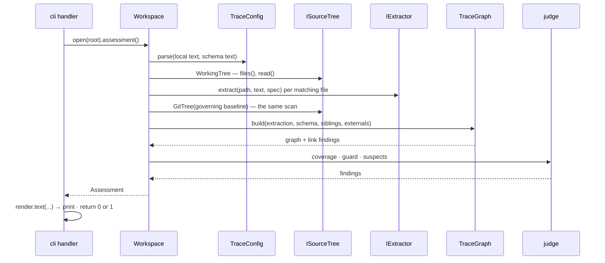

# qmstrace — Codebase Blueprint (slice 1)

> Inputs: [Product Requirements](../req/qmstrace-prd.md) · [Data Architecture](../design/data-architecture.md) · [Surface Architecture](../design/surface-architecture.md) · [System Architecture](../design/system-architecture.md) · [Progress tracker](../progress/overview-qmstrace.md) · [Scenario catalogue](../tests/scenario-catalogue.md) · the framework as installed: Typer 0.27.2, `uv_build`, Python 3.13 · Date: 2026-09-21

The design docs are this document's input, and it has standing to amend them. **The findings
are the value**; the tree and the types are the forcing function that produced them.

## 1. Findings — where two documents, or a document and the framework, could not both be true

Verified by running code where it says so.

| # | What collided | Resolution |
|---|---|---|
| F1 | **Surface doc's exit codes × the framework.** `2` = violations, `3` = usage. The framework exits `2` on a usage error and `1` on an abort or an uncaught exception *(verified)* | `0` no failing findings · `1` the check failed · `2` could not judge · `3` internal error. Surface doc amended |
| F2 | **The plan's `main()` × Typer 0.27.** The plan caught the click library's exceptions to map exit codes. This Typer vendors click privately and the `click` package is not installed at all *(verified: `import click` fails)* | Never import click. Typer owns usage errors; a decorator on each handler maps *our* outcomes — returned int, `CouldNotJudge` → 2, anything else → 3 *(verified: all six cases)* |
| F3 | **D9's embedded copy × TOML.** Schema and configuration both declare `[items.requirement]`; a TOML parser refuses a table declared twice *(verified)* | The copy lives under its own `[schema]` namespace. D9 amended |
| F4 | **D9's copy × ledger-relative paths.** With the schema copied, the paths to the agreement and the change requests no longer resolve | An optional local `ledger` pointer; without it, external sources are *not verified* |
| F5 | **D6's subject scope × the configurations.** A baseline freezes a subject; no configuration named one | `[subjects.<name>] key = …`; the stanza names the subject |
| F6 | **PRD success criterion 4 × dispatch by type name.** "A second trace schema needs no engine change" — the stand-in parsed an item type as tests only if it was literally called `test_case` | The extractor is named per item type in the configuration |
| F7 | **D6 "reachable from `HEAD`" × a pipeline's default checkout** — shallow, no tags. The guard would be off while the gate passes | With baselines configured, known incomplete history is *could not judge*. M5a states the offline limit: remote-tag completeness cannot be inferred from local refs |
| F8 | **D7 "never clears by being touched" × the stand-in**, which tracked test cases by file and cleared a suspect when its item was edited | Item-level digests for every item type; the suspect rule written out in D7 |
| F9 | **The stand-in's two glob matchers × each other** — they disagree on `src/**/*.py` *(verified)* | One matcher from the standard library, for every tree. Python 3.13 |
| F10 | **D4's in-memory database × a check that runs fifteen times a session** over a few hundred items | The database arrives with the ledger. The guarantee is kept by construction: an illegal link never enters the graph. D4 amended |
| F11 | **Verb → action → field.** Every verb the surface doc promises was walked to a use case and a field. `impact` had no reference behaviour; `init` did not say how it registers the test framework's marker; `results` did not list inspection-verified requirements apart; `thread` did not label its edges | Each is now specified in the scenario catalogue. The `ledger` verbs land nowhere in slice 1 — they are parked, and the surface doc marks them planned |
| F12 | **Package data × the build backend.** A skill and templates must ship inside the wheel | `uv_build` includes files under the package directory *(verified: a wheel was built and the asset found in it)*. Milestone M1 repeats this in CI |

## 2. Forks — where each was settled

| Fork | Settled | Where |
|---|---|---|
| **Use-case ownership** | `Workspace.assessment()` sequences *scan → graph → judge* once and holds nothing mutable; a command renders the result. No use-case object per command | slice tracker § Module shape |
| **Failure model** | A problem in the *user's repo* is a **finding — data, never an exception**; extractors return findings, they do not raise. An inability to judge is one exception, `CouldNotJudge`, carrying the next move. Anything else is an internal error. The user sees exit `0 / 1 / 2 / 3` | F1, F2 |
| **Boundary thickness** | Typer's types stay in `cli.py`. A handler takes plain values and returns an int; `core` never sees the framework | developer's survey of existing CLIs; F2 |
| **Wiring and substitution** | `Workspace.open(root, *, git=None)` — a test passes its own tree or Git; extractors are looked up by the name the configuration gives. No container, no composition root | Modular tier, chosen by the developer |
| **Tree axis** | By layer | Modular tier |
| **Concurrency** | Not applicable — a single-threaded command-line tool | — |
| **Prescriptiveness** | 💡 **Conceptual.** Signatures here are sketches; the invariants table carries what is worth enforcing. Pinned signatures rot at the first refactor | this document's judgement |

## 3. The tree

```
src/qmstrace/
  __init__.py            the version, read from package metadata — nothing else
  cli.py                 Typer wiring only: options, the @outcome decorator, exit codes. No logic
  workspace.py           Workspace.open(start).assessment() — the one place that sequences a run:
                         finds the root, reads the configuration, holds the one scan function;
                         results(report_path) reads the explicit report and assesses once
  core/                  pure — no file, no Git, no framework
    errors.py            CouldNotJudge — the one way a run says it could not judge; carries the next move
    model.py             Item, Link, Lead, Finding, Notice, Extracted — frozen dataclasses;
                         ID_TOKEN, what reads as an ID at all; text_digest — item text, digested
    config.py            TraceConfig.parse(local_text, schema_text) — validate, merge, provenance
    graph.py             TraceGraph.build(config, extracted, Surroundings) -> (graph, findings);
                         node() and its Home; incoming/outgoing; forward/backward -> Closure —
                         each item once, nearest first, the link that reached it and any other
                         (`also`); thread, impact and suspects render it; closest()
    judge.py             coverage (M3) · resolve_baselines · guard · suspects — pure functions
    baselines.py         frozen tag evidence, historical snapshots, request register and item
                         comparisons (M5a), suspect values and per-root reasons (M5b); no IO
    results.py           frozen report/result values; pure exact matching, run deduplication and
                         direct-verifies verdict aggregation (M4)
    findings.py          the catalogue: each code once — what is wrong, the next move
    assessment.py        Assessment: violations, gaps, suspects, notices, frozen state, what was scanned
  extract/               text in, items out — never a path, never a repo
    base.py              IExtractor, the registry by name; FORMS — how each extractor's items
                         write a link, for a gap's next move (M3)
    fields.py            the field line `Key: value` — shared by every extractor that reads fields
    markdown.py          headings, fields, fences, item text and its digest
    python_module.py     the module docstring's Implements line
    pytest_tests.py      test functions, verifies markers, own digest; report_identity(node_id)
    junit.py             bytes -> Report entries or parse diagnostic; safe defusedxml, no files
    change_requests.py   request text preamble -> metadata or diagnostic; no IO, no approval
                         inferred from examples or prose
  infra/                 everything that touches the world
    tree.py              ISourceTree · WorkingTree — files(), read(), label · GitTree (M5a)
    git.py               the one subprocess helper, run where it asks, redirects scrubbed ·
                         working_files() · IGit, GitCli — reachable tags, files at a revision (M5a)
    externals.py         raw change-request directory reads (M5a). The agreement and siblings need
                         no module: they are read as WorkingTrees
    globbing.py          the one matcher, for every tree
  render/
    text.py              status, findings, rules, thread, impact, results — functions -> str
  assets/                skill/SKILL.md · stanza.md · init templates — package data
tests/
  unit/                  core and extract, on text — no Git, no disk
  integration/           real Git in tmp_path, a scrubbed environment, session-scoped templates
  cli/                   CliRunner against golden text files
  fixtures/mini/         the hand-made miniature project, plain files
  conftest.py            project (the fixture project as real Git repos) · alone (one repo as a
                         pipeline checks it out) · make_repo · git_env (a scrubbed environment)
  test_architecture.py   the import matrix, enforced
  test_catalogue.py      every command has a golden; every code has a fixture that emits it
  test_manual.py         the user manual: a page per command, a TL;DR per page, every page in
                         nav, includes only from tests/; the findings-table golden
  cli/golden/            command output and help — the goldens the manual includes
  manual/findings.md     the findings table, rendered from core/findings.py
  test_skill_parity.py   every marker example in the skill parses; every code has catalogue text
```

Beside the package: `contents/` — the user manual, built by Zensical from `zensical.toml` and
published by Netlify from `netlify.toml` ([writing it](../dev/writing-the-manual.md)). It imports
nothing from the package: it includes files that tests own.

💡 `workspace.py` and `cli.py` sit at the package's top level, outside the four packages: they
are the only modules allowed to know all of them.

## 4. Seams

| Seam | Why it is real | Varies today | Later |
|---|---|---|---|
| `ISourceTree` | The same scan reads "now", "at a baseline tag" and a sibling | working tree · tree at a revision | a pin, at the ledger's import |
| `IExtractor` | One per source type, named in the configuration | Markdown · Python module · pytest | another test framework |
| `IGit` | Git's own semantics are the risk — reachability, annotated tags, shallow clones | the command-line client | — tests use a **real** Git in a scrubbed environment, not a fake |

`IGit` has one implementation and is still an interface: it is domain-shaped — *reachable
tags*, *files at a revision* — so `core` and `workspace` never see a subprocess, and a unit
test of `workspace` can hand in a stub tree without Git at all.

## 5. A run, at object granularity



`CouldNotJudge` may be raised by `config`, `tree` or `git`, by pure baseline resolution when
ancestry or subject ownership is ambiguous, and by `workspace` while it finds the
repo and reads its configuration — nowhere else; `@outcome` turns it into exit `2` with its next
move. A sibling that cannot be judged is not this repo's failure: `workspace` turns it into what
the header says about that sibling.

## 6. The import matrix

Rows may import columns. Enforced by `tests/test_architecture.py`, which walks each module's
`ast` — the pattern the developer's own tools already use — so it needs no new dependency.

|  | core | extract | infra | render | workspace | cli | typer | stdlib |
|---|---|---|---|---|---|---|---|---|
| **core** | ✔ | — | — | — | — | — | — | ✔ |
| **extract** | ✔ | ✔ | — | — | — | — | — | ✔ |
| **infra** | ✔ | — | ✔ | — | — | — | — | ✔ |
| **render** | ✔ | — | — | ✔ | — | — | — | ✔ |
| **workspace** | ✔ | ✔ | ✔ | — | — | — | — | ✔ |
| **cli** | ✔ | — | — | ✔ | ✔ | — | ✔ | ✔ |

`extract` also imports `defusedxml`, in `junit.py` only. Nothing imports `click`.

M4's report boundary is not an item extractor and is not registered in `IExtractor`.
`Workspace.results` reads explicitly supplied bytes (outside the Git-filtered tree), converts
parse diagnostics and zero matches to `CouldNotJudge`, obtains identities from
`pytest_tests.report_identity`, then calls `core.results.summarize`. The CLI resolves the
report path before opening the workspace. Matching and aggregation stay in core; the renderer
only presents frozen values. Graph nodes retain authored fields for sibling verification
methods without making sibling nodes local items. No pytest runtime import is needed.
`types-defusedxml` is a development dependency for strict mypy; runtime dependencies are unchanged.

M5a adds optional `git=` injection to `Workspace.open`, a domain-shaped `IGit` implemented by
`GitCli`, and `GitTree`. Reads resolve to immutable commits; Git redirects are scrubbed and
lazy object fetching is disabled. The workspace first selects scope candidates from ancestry,
then caches selected historical snapshots by commit and reuses the scanner. Historical scans
never recurse into sibling assessments or baseline resolution. The historical configuration
and any referenced schema must come from that Git tree; the current ledger is not a fallback.
`Assessment.baseline_state` contains tags, comparisons and request availability. Rendering
derives labelled counts from those comparisons; judgment remains in `core/judge.py`.
M5a and M5b add no configuration keys or dependencies. Suspect traversal reuses these snapshots.


## 7. Where a change lands

M5b's frozen `Suspect` and `SuspectReason` values live alongside baseline comparisons in
`core/baselines.py`; snapshots retain their validated local graph. `core/judge.py` computes
per-root reach and digest comparisons without IO. Workspace scans a tagged tree once per
commit and never completes it from current external files. Assessment carries the complete
suspect list; renderers format status summaries and the catalogue's S01 text without
deciding eligibility. The check failure predicate remains violations plus strict gaps.

| Asked to… | The one file |
|---|---|
| reword a finding, or change its next move | `core/findings.py` — a gap's wording too; its code and text are the schema's |
| change how a marker is written in a next move | the extractor's `form()` — `tests/unit/test_forms.py` round-trips it |
| add a finding code | `core/findings.py`, the function in `core/judge.py` or `core/graph.py` that emits it, a fixture — `test_catalogue.py` fails until all three exist |
| add a coverage rule | no code — the trace schema |
| read a new marker form, or another test framework | one new file in `extract/`, registered by name |
| change what counts as an item's text | `extract/markdown.py` — and D-series in the design doc, because it moves every digest |
| change how a baseline is chosen | `core/judge.py` `resolve_baselines` |
| change what Git is asked | `infra/git.py` |
| change a command's output | `render/text.py` and its golden file — then `rg <golden> contents/` for the prose that frames it |
| change which items a walk reaches, or in what order | `core/graph.py` `_walk` — `thread`, `impact` and suspects all render it; `tests/unit/test_graph.py` § walks pins the rules |
| add a command | `cli.py` (wiring, and a `short_help` that fits the command list), `render/text.py`, goldens for its output and its help, a page in `contents/reference/commands/` — `test_catalogue.py`, `test_help.py` and `test_manual.py` fail without them |
| change a configuration key | `core/config.py`, both test-bed configurations, the `init` template |
| change what the agent is told | `assets/skill/SKILL.md` or `assets/stanza.md` — `test_skill_parity.py` guards the examples |

## 8. What is deliberately absent

- **No `Judge` class.** It would hold no state; four pure functions are deeper than one object
  with four methods and a constructor.
- **No repository pattern, no service layer, no composition root.** The Modular tier earns
  none of them; `Workspace` is the only sequencer.
- **No renderer interface.** There is one renderer. It becomes an interface the day a second
  form exists, and findings are already data so that day is cheap.
- **No fake Git.** A fake would encode assumptions about exactly the semantics under test.
- **No database.** Until the ledger.
- **No plugin system.** Extractors are a registry by name inside the package until two exist
  outside it.
- **No `utils.py`, no barrel re-exports.** `__init__.py` files are empty but for the version.
- **No pydantic, no rich.** Dataclasses and plain text; the tool installs with Typer and
  `defusedxml`.
- **No use of the framework's private modules.** Typer's vendored click is not ours to import.
- **No second item type named in `status`.** It lists `requirement` items and reads `Category`
  and `Verify-by` by name — a known hard-coding in `render/text.py`, since every trace schema so
  far uses those names. Everything else it prints comes from the configuration. Revisit when a
  second schema does not.

## 9. Invariants

★ = a test or tool checks it.

| Invariant | Checked by |
|---|---|
| ★ `core` imports only `core` and the standard library; nothing imports `click` | `test_architecture.py` |
| ★ Every registered command has a golden output | `test_catalogue.py` |
| ★ Every finding code has catalogue text and a fixture that emits it | `test_catalogue.py` |
| ★ Every command has a help golden and a reference page in the user manual | `tests/cli/test_help.py`, `test_manual.py` |
| ★ Every manual page opens with a TL;DR and is in the navigation | `test_manual.py` |
| ★ The manual includes only goldens and fixtures under `tests/`, and a missing one fails the build | `test_manual.py`; `pymdownx.snippets` `check_paths`; `just manual-build` (strict) |
| ★ Every marker example in the shipped skill parses with the real extractors | `test_skill_parity.py` |
| ★ Two runs of any command on the same tree give identical bytes | `tests/cli/` |
| ★ Exit codes: a usage error 2, `CouldNotJudge` 2, a raised exception 3, never a bare traceback | `tests/cli/test_exit_codes.py` |
| ★ An extractor takes text and never opens a file | `test_architecture.py` — nothing in `extract` imports a file-system module or calls `open`, `read_text` and their kin |
| ★ Every import is absolute, so the matrix cannot be walked around | `test_architecture.py`; ruff `TID252` |
| ★ The working tree is what a commit could carry — an ignored file is never read | `tests/integration/test_tree.py` |
| ★ The wheel contains the skill and the templates | CI, M1 |
| ★ An illegal link never enters the graph | `tests/unit/test_graph.py` — `build` returns it as a finding instead |
| ★ A walk reaches each item once, nearest first; forward crosses a link that counts toward no coverage, backward stops at it | `tests/unit/test_graph.py` § walks |
| ★ A sibling's item is a node but never this repo's own item | `tests/unit/test_graph.py`; the `status` goldens |
| ★ Every marker form a gap suggests round-trips through the extractor that reads it | `tests/unit/test_forms.py` |
| ★ Gaps are judged on this repo's items; `Assumes` counts toward none; a gap whose link was refused names the violation | `tests/unit/test_judge.py` |
| ★ Every finding, violation or gap, ends with a next move | `tests/test_catalogue.py` |
| ★ A citation this run cannot verify passes as *not verified here*; an ID of this repo's own pattern never does | `tests/unit/test_graph.py`, `tests/integration/test_workspace.py` |
| ★ A suspect survives a touched file | `tests/integration/test_suspect_assessment.py` |
| A problem in the user's repo is a finding, never an exception | review; `extract/` has no `raise` outside parse failures it converts |
| `cli.py` holds no logic | review; its handlers are open → render → return |

## 10. Decisions that overrule a design doc

| This entry | Overrules | Marked there |
|---|---|---|
| F1 — exit codes | Surface Architecture § Interaction & State, first form | amended in place |
| F3, F4, F5, F6 — the configuration's shape | Data Architecture D9, first sketch; *The trace configuration* | amended in place |
| F7 — could not judge on a shallow clone | Data Architecture D6 | amended in place |
| F8 — the suspect rule | Data Architecture D7, first form | amended in place |
| F10 — the database arrives with the ledger | Data Architecture D4 | amended in place |
| F2 — never import click | the approved plan's `main()` sketch | slice tracker § Module shape |

All of these change **structure**. None removes a behaviour the surface doc promises.
