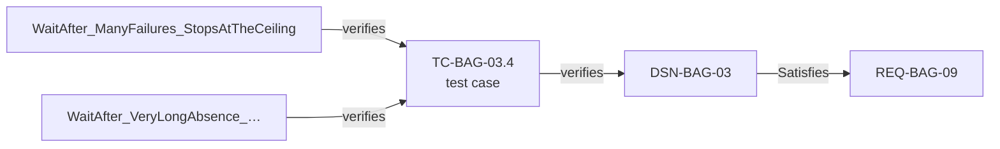

# beacon-dotnet — the C# capability's test bed

**Status: built 2026-10-14; measures C1–C13 fixed 2026-10-14; not yet run.** The run needs
the C# milestone's engine. Bed commits: ledger `dd65081` (tag `dotnet/requirements/1` at `493fc47`),
gateway `028bde5`, agent `c2520dd` — the build's (`493fc47`, `bac8d3f`, `76f610b`), reworded in
M12-0.

Fixing the measures revised the proposal in four ways:
- every measure now names exact expected values;
- C2 breaks each new rule on purpose;
- C6 no longer expects DSN-BAG-03 to fail, because no verdict flows through a design element;
  it adds a break whose failure reaches a requirement through its test cases;
- C12 (setup) and C13 (no regression on beacon-split) are new.

**Amended 2026-10-14, in M12-0, before the run.** C9's `CommentedOut` row no longer expects a
stray to be seen: a stray is printed only when a gap names it, and no gap in the probe copy
names `TC-BAG-90.15`, so the run could not observe it. The stray is pinned by the C# extractor's
unit test instead; C9 still requires that the method yields no automated test. The bed's
wording "register" became "test specification".

Settled 2026-10-14:
- the ID at the start of a DisplayName names a **test case in a test specification** in the ledger;
- an ID may contain **dotted number segments** (`TC-BAG-03.1`, `DSN-XYZ-04.1`);
- the C# tests model the gateway **in memory**;
- test cases are numbered **`TC-BAG-NN.m`**;
- the code that runs a test case is an **automated test**;
- the document that holds test cases is a **Test Specification** (the glossary keeps
  *Register* for a generated listing).

## What is tested

Whether qmstrace traces a C# product repo as faithfully as it traces a Python one. The C#
repo's conventions are those of the first C# adopter:

- xUnit `[Fact]` and `[Theory]` tests whose `DisplayName` starts with a test-case ID;
- several tests sharing one test case, which passes only when all of them pass;
- test cases planned in a test specification, a document that sits outside the code;
- dotted IDs that encode a hierarchy, which the adopter never renumbers;
- results reported as TRX, the format `dotnet test --logger trx` writes.

The new chain is **automated test → test case → design element / requirement**:



## Why this bed

- **Beacon's field agent already does what the adopter's C# code does.** It registers, sends
  a heartbeat at a cadence, and backs off while the gateway is away. The C# tests can take
  the adopter's shapes without copying its code.
- **The Python agent is the oracle.** The C# agent carries the same requirement and design
  IDs. A `ledger check` must therefore cover the same items and leave the same gaps as on
  beacon-split. That catches extractor mistakes without trusting the extractor.
- **One ledger, two languages, both conventions.** The Python gateway keeps verifying
  requirements directly; the C# agent verifies them through the test specification. The schema allows
  both.
- **No new requirements to write.** The agreement, the SRS, the design and the change
  requests come from beacon-split. beacon-split's tags are M10 evidence, so it is cloned,
  never reshaped.

## Layout

```
beacon-dotnet/
├── beacon-ledger/       from beacon-split, plus docs/test/field-agent-test-cases.md (the test specification)
├── beacon-gateway/      from beacon-split, Python and pytest; its tests are automated_test items
└── beacon-agent-cs/     new
    ├── Beacon.Agent.sln, Directory.Packages.props, qmstrace.toml, AGENTS.md, README.md
    ├── src/Beacon.Agent/             AgentSettings, GatewayClient, WaitSchedule, ReportingCycle, Runner
    └── tests/
        ├── Beacon.Agent.Tests/       Unit/ Integration/ System/ Support/ — traced
        └── Beacon.Agent.Probe/       one test per xUnit shape, for the extractor — not traced
```

| Python module | C# file | Design element | Tests (unit · integration · system) | Test cases |
|---|---|---|---|---|
| `config.py` | `AgentSettings.cs` | DSN-BAG-01 | 7 · — · — | `TC-BAG-01.1–.6` |
| `gateway_client.py` | `GatewayClient.cs` | DSN-BAG-02 | 6 · 7 · — | `TC-BAG-02.1–.11` |
| `schedule.py` | `WaitSchedule.cs` | DSN-BAG-03 | 7 · — · — | `TC-BAG-03.1–.6` |
| `cycle.py` | `ReportingCycle.cs` | DSN-BAG-04 | 11 · — · — | `TC-BAG-04.1–.11` |
| `runner.py` | `Runner.cs` | DSN-BAG-05 | 6 · — · — | `TC-BAG-05.1–.6` |
| the whole agent | — | — | — · — · 9 | `TC-BAG-00.1–.9` |

That is 53 automated tests running 49 test cases. In TRX they produce 67 results, because
the Theory rows count separately, just as pytest's parametrised runs do. Four test cases are
shared by two methods each:
- `TC-BAG-01.3`, `TC-BAG-02.4` and `TC-BAG-03.4` at one level;
- `TC-BAG-02.1` across two levels, a unit test on the wire and an integration test against
  the guard.

Package pins match the adopter's: xunit 2.9.3, xunit.runner.visualstudio 4.0.0,
FluentAssertions 7.2.2 (the Apache-2.0 line), NSubstitute 6.2.0, Microsoft.NET.Test.Sdk
18.10.0, coverlet.collector 10.0.1. The target is `net10.0`, the one runtime on the build
machine. The adopter targets `net8.0`, but the source syntax the extractor reads is the same.
The code is formatted with CSharpier 1.3.0.

## The port

A component declares its design element in the leading XML doc comment of its file's first
type, the C# counterpart of a module docstring. Each file mirrors one Python module, so the
small types a module also holds (`ConfigException`, `IGateway`, `StepOutcome`) sit in its
file:

```csharp
/// <summary>How long the agent waits before its next call.</summary>
/// <remarks>
/// …
/// Implements: DSN-BAG-03
/// </remarks>
public static class WaitSchedule
```

An automated test names its test case at the start of its `DisplayName`. CSharpier wraps a
long attribute over three lines, which is a shape the extractor must read:

```csharp
[Fact(DisplayName = "TC-BAG-03.4 the wait stops growing at the ceiling")]
public void WaitAfter_ManyFailures_StopsAtTheCeiling() { … }

[Fact(
    DisplayName = "TC-BAG-02.7 a heartbeat is accepted under the same client ID that registered"
)]
public async Task Heartbeat_AfterRegistering_IsAcceptedUnderTheSameClientId() { … }
```

The test specification, in the ledger, plans each test case and says what it verifies. A group
heading must not *start* with an ID: `## DSN-BAG-03 — Wait schedule` declares DSN-BAG-03 a
second time and is reported (V07). The heading is `## Wait schedule (DSN-BAG-03)`:

```markdown
## Wait schedule (DSN-BAG-03)

### TC-BAG-03.4 — The wait stops growing at the ceiling
verifies: DSN-BAG-03
```

**Numbering.** `TC-BAG-NN.m` is test case *m* of the tests that exercise design element
`DSN-BAG-NN`, and `00` is the system tests of the whole agent. It mirrors the adopter's *test
of an element* without its three-part `NN.m-kk`, because beacon's design elements carry no
requirement number. The ID is a name; the `verifies:` line is the link.

**The gateway is modelled in memory.** The Python agent's integration and system tests run
the real gateway inside the test process. A C# test cannot host a Python app that way, so
`Support/FakeGateway.cs` models the gateway's API, as the adopter does: the API-key guard,
the payload limited to a client ID, registration and heartbeat, the operator's list and the
derived offline state. The two languages meet in the ledger, not at runtime. Starting the
Python gateway as a process instead would lose the hand-moved clock the system tests depend
on.

**No listening port (REQ-BAG-07).** The Python test takes `socket.bind` and `listen` away
while the agent runs; .NET has no such switch. The C# test runs the same working life, and
also reads the agent assembly's metadata for any reference to a listening API
(`TcpListener`, `HttpListener`, `UdpClient`, `Socket.Bind/Listen/Accept`, ASP.NET Core).
`TC-BAG-00.2` shows the guard finds a deliberate `TcpListener`.

**A namespace segment named `System`** (from the `System/` folder) shadows the `System`
namespace inside sibling namespaces. A `System.`-qualified name inside a namespace body
fails to compile, so the test project uses `using` directives instead.

**The schema changes, from beacon-split:**
- `test_case` becomes the test specification's entry, and a new type `automated_test` (pytest functions
  and xUnit methods) carries the levels.
- `verifies` runs from `automated_test` and `test_case` to `requirement`, `design_element`
  and `test_case`. It is one link, so G02 and G04 stay as they are, satisfied directly or
  through a test case.
- G07 moves to `automated_test`. There are two new rules: a test case verifies something
  (G08), and an automated test runs it (G09).
- `[repos] agent = "../beacon-agent-cs"`, and baselines are this bed's own
  `dotnet/requirements/<n>` tags.
- One looseness: a test case could verify another test case. Targets that depend on the
  source type would close that gap, and are left to the engine.

The terms **automated test** and **test specification** entered `CONTEXT.md` in M12-0, with
ADR-0003; qmstrace's own schema follows in M12b. The glossary's **Test Case**
already means the planned entry: *the planned, baselined description of a test and what it
verifies*.

## Verified while building — 2026-10-14

- **Tests.** `dotnet test --logger trx`: 67 results, all passed (53 methods). The probe
  project: 18 results, with the planted failing row and the planted skip.
- **Parity with the Python agent**, by script. Every Python test was paired with its target,
  and every C# method with its test case's `verifies:` line, each with its level. The two
  multisets of (level, target) are **identical**: 53 on each side, all 49 test cases run by
  at least one automated test. This is the construction check, not measure C1; C1 is
  qmstrace's own reading.
- **Mutation checks**, each in a disposable copy, which was then removed. One behaviour was
  broken at a time, and these test cases failed in TRX:

| Broken | Failing test cases |
|---|---|
| no ceiling in `WaitAfter` | both `TC-BAG-03.4` tests, and nothing else |
| the trailing slash kept | `TC-BAG-01.5` |
| an extra field sent | `TC-BAG-02.2`, plus every test through the gateway: 15 in all, because the fake refuses unknown fields as the gateway does |
| no API key sent | `TC-BAG-02.1` (both methods), plus every test through the gateway: 15 |
| the failure count never reset | `TC-BAG-04.7`, `TC-BAG-04.10`, `TC-BAG-00.8`, `TC-BAG-00.9` |
| the loop ignores the wait | `TC-BAG-05.3`, `TC-BAG-05.5`, `TC-BAG-00.5`, `TC-BAG-00.7` |
| the agent can listen (an unused `TcpListener`) | `TC-BAG-00.1` |

- **beacon-split untouched (C11, early).** `HEAD`, branches, tags and `status --porcelain`
  are identical before and after the build, in all three repos.

## M0 — today's engine (`75ba627`) on the bed

| Run | Seen |
|---|---|
| gateway `check --strict` | exit 0, 85 items, 0 violations, 0 gaps: the rename to `automated_test` changed nothing |
| `ledger copy-schema` | exit 2, nothing written: *agent … names the extractor 'csharp-file', which this qmstrace does not have*. `copy-schema gateway` alone succeeds |
| `ledger check` | exit 2, refused: the agent's configuration has no schema block. It refuses rather than passing with a repo unread |
| the ledger's own `check`, before the tag | exit 1: **49 V02, one per dotted test case, each naming a cut-short ID** (*TC-BAG-00 does not match … ^TC-BAG-\d{2}\.\d+$*), and no test-case item read; plus beacon-split's 47 gaps (G02 21, G03 13, G04 13) |
| the ledger's own `check`, after the tag `dotnet/requirements/1` | exit 2, refused: *Historical trace data at dotnet/requirements/1 … cannot form a reliable snapshot*. The tagged tree holds the same 49 misread headings, so it refuses rather than judge baselines on a snapshot it cannot read. The refusal lists all 49 V02 in one line of 6.7 KB. The gateway's `check --strict` still exits 0 |
| the same, with the dots replaced by hyphens, in a disposable copy (before the tag) | exit 0, **0 violations, 49 test cases read**. G02 21 → 11 and G04 13 → 8, met through the test specification; 49 G09, because the C# repo cannot be read yet. `thread TC-BAG-03-4` walks through DSN-BAG-03 to REQ-BAG-02/09/10 and AGR-7/9 |

So the test specification works through configuration alone for the ledger's own commands. Today, the
dot is the only thing in the way.

## What the probes found — verified 2026-10-14

`dotnet test --logger trx` was run on the probe project and the TRX file was read back.

| Shape | What xUnit and TRX do | What it decides for the extractor |
|---|---|---|
| Any test | `TestMethod className` = the namespace-qualified class; `name` = the method | Join results on class and method, never on the `DisplayName`, which changes whenever a test is reworded |
| `[Theory]` rows | `testName` = `DisplayName(failures: -1, cadenceSeconds: 30)`, one result per row, all with the same class and method | One automated test per method; rows combine by worst verdict |
| `[MemberData]` with a string | `…(value: 2, label: "two, with a comma")` | The same; parse no parameters out of `testName` |
| No `DisplayName` | `testName` = `Beacon.Agent.Probe.Shapes.NoDisplayName_Runs` | An automated test that verifies nothing (G07) |
| `const`, `Id + "…"`, `$"{Id} …"` | compiles, and TRX shows the resolved text | A `DisplayName` that is not a single literal is reported as unread (or resolved within its type): legal C#, so it must never be skipped silently |
| Raw `"""…"""`, verbatim `@"…""…"` | compiles, read as written | The lexer must read all three string forms |
| An attribute wrapped over lines (CSharpier) | compiles, read as written | Read across line breaks |
| `Skip = "…"` | outcome `NotExecuted` | Verdict `skip` |
| `[Fact, Trait("verifies", …)]` | **the trait never reaches the TRX file** | The `DisplayName` is the one marker form; a `Trait` named after a link is reported, never read |
| `[Xunit.FactAttribute(…)]` | runs | Read, like `[Fact]` |
| `[SlowFact]` (a subclass of `FactAttribute`) | runs as a test | Reported as unread; an extractor cannot see the base class in another file |
| Nested class | `className` = `Shapes+Nested` | The identity uses `+` for nesting |
| Block-scoped namespace | `className` qualified as with a file-scoped one | Read both forms |
| `[Fact]` on an abstract base, two subclasses | **two results**, `className` = each subclass; the source declares it once | Open: one automated test with two runs, or one per subclass |
| `#if NEVER_DEFINED` around a test | absent from TRX | Reported, never extracted as if it ran |
| A commented-out `[Fact]` above a public method | not run; the xUnit analyzer warns `xUnit1013` | A stray, as with Python |

Running `dotnet test` needs the VSTest host's loopback socket, which the agent sandbox
blocks. Build and restore work inside it, offline from the NuGet cache.

## Left to the engine milestone

- **Parsing C#:** tree-sitter-c-sharp (recommended), a hand lexer, or Roslyn (needs the .NET
  SDK wherever qmstrace runs, so rejected).
- **An automated test's ID:** `path::Class::Method`, matching pytest, with namespace and class
  kept for the TRX join.
- **Which link a `DisplayName` declares:** the one link its type can carry (`verifies`), or a
  field in the configuration.
- **A level from a PascalCase folder** (`Unit/`, `System/`) against the schema's `unit`.
- **Inherited tests** (the probe row above).
- **Components where one type is one file.** The bed keeps module-shaped files. A repo with a
  file per type would show G06 on every helper type's file. Decide whether a component is a
  file or a type that carries the marker.
- **The G02 next move.** With `test_case` declared in the ledger, a gateway requirement's G02
  says to write `verifies:` under a test case. But the gateway verifies directly, from
  pytest, with no test specification. The fix should name every way the link can be made.
- **Verdicts through a test case in `results`:** today only direct `verifies` links count.
  This amends `surface-architecture.md` and needs an ADR.
- **Dotted IDs:** one pattern in `core/model.py`, read by every extractor. This amends marker
  syntax v0 and needs an ADR. Separately, a dotted ID is cut short today, as M0 shows end to
  end for headings; the regular expressions show the same for tables, strays and mentions. It
  is a bug to fix whatever else changes.
- **The agent's schema block.** `ledger copy-schema agent` fills it once the engine reads C#,
  and `init` then installs its stanza and skill.
- **A refusal over many violations at a baseline tag** lists every one of them in a single
  line. It should summarise them, and say how to see them, for example by checking at the tag.

## How it is built

1. Clone beacon-split's `beacon-ledger` and `beacon-gateway`, then remove `origin` from
   each. Record beacon-split's `HEAD`, branches, tags and status.
2. Create `beacon-agent-cs` with the `dotnet` templates: `new sln --format sln`,
   `new classlib`, `new xunit` (twice), `new packagesprops`, `new gitignore`. Pin the
   packages centrally, and make `Beacon.Agent` an executable with `InternalsVisibleTo` for
   the tests.
3. Port the five modules and the 53 tests, each DisplayName starting with its test case's ID.
   Format with `csharpier format .`. Check parity and run the mutation checks.
4. In the ledger:
   - add the test specification;
   - apply the schema changes;
   - add `[items.test_case]` with `id_pattern = '^TC-BAG-\d{2}\.\d+$'`.
5. In the gateway, rename `[items.test_case]` to `[items.automated_test]`. In the ledger, run
   `ledger copy-schema gateway`; the agent's copy needs the C# engine.
6. Refresh the skill and stanza in the ledger and the gateway: remove the unedited old
   `SKILL.md`, then run `qmstrace init`.
7. Commit each repo, then tag the ledger `dotnet/requirements/1`.
8. For the run, build the engine from the C# milestone's branch and install it into
   `beacon-dotnet/.engine-venv`.

## Measures — fixed 2026-10-14, before the run

The run uses the C# milestone's engine, built from its branch and installed into
`beacon-dotnet/.engine-venv`; the run records the commit and the wheel's sha256.

- A measure passes only as written. A partial result is recorded as partial, with what was
  seen.
- Every break is made in a disposable copy, never in the bed, and the copy is removed
  afterwards.
- The expected values come from the bed as built (above) and from beacon-split read by
  `75ba627`, 2026-10-14.
- Where the milestone still chooses the mechanism (an automated test's ID, inherited tests,
  constant `DisplayName`s), a measure pins the outcome and allows the choices that keep it.

**The oracle: beacon-split on `75ba627`.**

| Run | Seen |
|---|---|
| `ledger check --strict` | exit 0; 177 items: agent 5 components · 53 test cases; gateway 9 · 76; ledger 21 requirements · 13 design elements. 0 violations, 0 gaps, 0 suspects; 21 frozen |
| each repo's `status` | links: agent 58, gateway 93, ledger 57 — 208 |
| `ledger thread REQ-BAG-09` | forward: 1 design element (DSN-BAG-03), 1 component, 8 test cases (7 unit, 1 system); backward: AGR-9 |
| `ledger impact REQ-BAG-09` | downstream: 1 design element, 1 component, 8 test cases; origin AGR-9; candidate `Impacts: REQ-BAG-09` |

**Order of the run:** C12 (setup), C13 (no regression), C1–C9, C10 over the commands it
names, then C11.

| # | Step | Passes when |
|---|---|---|
| C1 | `ledger check --strict` | exit 0 · **226 items** across 3 repos: agent 5 components · 53 automated tests; gateway 9 components · 76 automated tests; ledger 21 requirements · 13 design elements · 49 test cases · 0 violations, 0 gaps, 0 suspects · 21 frozen, 0 changed (tag `dotnet/requirements/1`) · links by each repo's `status`: agent 58, gateway 93, ledger 106 (**257**) · each of the 10 BAG requirements and 5 BAG design elements is reached by `verifies`, as on beacon-split · wall time recorded, informational |
| C2 | `ledger check`, each break in its own copy | (a) the bed as built: no G07, G08 or G09 · (b) remove the ID from `TC-BAG-01.5`'s only test's `DisplayName`: exactly one G07 (that automated test) and one G09 (TC-BAG-01.5) · (c) delete TC-BAG-01.5's `verifies:` line: exactly one G08 · (d) add `TC-BAG-01.7`, with a `verifies:` line and no test: exactly one G09 · (e) delete TC-BAG-00.1's `verifies:` line: exactly one G08 (TC-BAG-00.1) and one G02 (REQ-BAG-07). The G02's fix offers both the test case's `verifies:` line and the automated test's own form, never the test case alone (M0's next move) |
| C3 | the agent's `status` | components: its five `src/Beacon.Agent/*.cs` files, each with one `Implements` link (DSN-BAG-01…05 in turn) · automated tests: 53, one per method — 37 unit, 7 integration, 9 system; no item per Theory row, none from `Support/` or the probe project, no no-level finding · each ID is derived from the test's location, is distinct, and names its file, class and method |
| C4 | `ledger check` and the ledger's `status` | the 49 test cases carry the test specification's IDs exactly · incoming links: TC-BAG-01.3, 02.1, 02.4 and 03.4 two each, every other test case one; TC-BAG-02.1, 02.10 and 02.11 are three items · no item and no link target `TC-BAG-00` … `TC-BAG-05` · M0's 49 V02 are gone |
| C5 | the agent's `results`, on three TRX files | (a) the full run: 67 entries, 67 distinct runs, 0 duplicates, 67 matched, 53 of 53 automated tests matched, 0 unmatched. All 53 automated tests, 49 test cases and 10 BAG requirements pass, and REQ-BAG-09's verdict comes through TC-BAG-00.7, 03.2, 04.6 and 05.3 · (b) a copy with `Skip` on TC-BAG-04.7's only test (67 rows, 1 skipped): that test, TC-BAG-04.7 and REQ-BAG-10 are `skip`; the other 9 BAG requirements pass · (c) `--filter "FullyQualifiedName!~WaitScheduleTests"` (58 rows): the 7 WaitSchedule tests and TC-BAG-03.1–03.6 are `no-result`, and so are REQ-BAG-02, 09 and 10; the other 7 pass |
| C6 | the agent's `results` after a break, each in its own copy | (a) the failure count never reset: TC-BAG-00.8, 00.9, 04.7 and 04.10 fail, and REQ-BAG-10 fails; the other 9 BAG requirements pass · (b) no ceiling in `WaitAfter`: both TC-BAG-03.4 tests fail, and TC-BAG-03.4 fails. All 10 BAG requirements pass, because no verdict flows through a design element. The failing test case is still shown, with what it verifies |
| C7 | `ledger thread REQ-BAG-09`; `ledger thread TC-BAG-03.4` | REQ-BAG-09 forward: DSN-BAG-03; `agent:src/Beacon.Agent/WaitSchedule.cs`; 7 test cases (TC-BAG-00.7, 03.2, 04.6 and 05.3 directly; 03.4, 03.5 and 03.6 through DSN-BAG-03); 8 automated tests, all `agent:`-qualified, 7 unit and 1 system as on beacon-split. Backward: AGR-9 · TC-BAG-03.4 forward: its 2 automated tests. Backward: DSN-BAG-03; REQ-BAG-02, 09 and 10; AGR-7 and AGR-9 |
| C8 | `ledger impact REQ-BAG-09` | downstream: 1 design element, 1 component, 7 test cases, 8 automated tests; upstream origin AGR-9; candidate `Impacts: REQ-BAG-09` |
| C9 | the probes: in a copy of the agent whose automated tests are `tests/Beacon.Agent.Probe/**/*.cs`, run `check`, then `results` on the probe's TRX | each probe as in the table below · each of the 18 TRX rows is either matched or listed as unmatched · the links to `TC-BAG-90.*` are V03 (they are not in the test specification), as expected |
| C10 | `ledger check` (plain, `--strict`, `--quiet`); C7's two threads; C8's impact; the agent's `status`, `check --strict` and `results` (C5 a). Each run twice | identical bytes; no absolute home path in any output |
| C11 | after the run | beacon-split: `HEAD`, branches, tags and `status --porcelain` unchanged since before the build · beacon-dotnet: every repo clean; each `HEAD` is the one in the status line above, or C12's in the agent |
| C12 | setup: `ledger copy-schema`, then `init` in the agent | `copy-schema` exits 0, with `updated: agent` and the gateway unchanged (at M0 it refused and wrote nothing) · `init`: the agent's stanza lists `component csharp-file` and `automated_test xunit` with their globs, and writes no pytest settings · both committed in the agent |
| C13 | beacon-split, read by the milestone's engine | `ledger check --strict` matches the oracle: 177 items, 208 links, 0 violations, 0 gaps, 0 suspects, 21 frozen · `ledger thread` and `ledger impact REQ-BAG-09` reach the oracle's items · each product repo's `check --strict` exits 0 (gateway 85 items, agent 58): widening the ID shape changes nothing that had no dot |

**Probe expectations (C9).** Each line must hold; where it allows two outcomes, it never
allows neither.

| Probe | Expected |
|---|---|
| `NoDisplayName_Runs` | an automated test with G07 |
| `ConstConcatenation_Runs`, `ConstInterpolation_Runs` | an automated test each, with an unread-marker finding, or a link to `TC-BAG-90.4` if the milestone resolves constants within a type |
| `RawString_Runs`, `VerbatimString_Runs` | links to `TC-BAG-90.5` and `TC-BAG-90.6` |
| `Skipped_IsNotRun` | a link to `TC-BAG-90.7`; `results`: `skip` |
| `Async_Runs`, `FullyQualified_Runs`, `Nested_Runs`, `Block_Runs` | links to `TC-BAG-90.8`, `.10`, `.16` and `.18`; each joins its TRX row (`Shapes+Nested`, `Beacon.Agent.Probe.Blocks.InABlockNamespace`) |
| `WithTrait_Runs` | a link to `TC-BAG-90.9` from the `DisplayName`, plus an unread-marker finding for the trait |
| `MemberData_Runs` | one automated test, linked to `TC-BAG-90.11`; both TRX rows join it |
| `OneRowFails` | one automated test, linked to `TC-BAG-90.12`; `results`: `fail` |
| `CustomAttribute_Runs` (`[SlowFact]`) | an unread-marker finding and its TRX row listed unmatched, or, if the milestone reads it, a link to `TC-BAG-90.13` and the row matched |
| `CompiledOut` (`#if`) | a finding; no automated test |
| `CommentedOut` | no automated test (amended in M12-0: its stray is pinned by the extractor's unit test) |
| `Inherited_Runs` | both TRX rows (`FirstDerived`, `SecondDerived`) join an automated test: one test with two runs, or one test per subclass, as the milestone records |

## Results

Not yet run: the run needs the C# milestone's engine. The build was verified as recorded
above. The TRX variants that C5 (b) and (c) need were produced once while the measures were
being fixed, to confirm the bed yields them: 67 rows with one skipped, and 58 rows.
