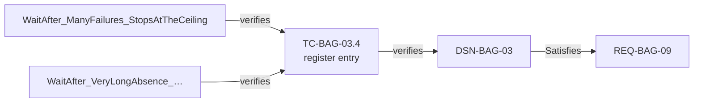

# beacon-dotnet — the C# capability's test bed

**Status: built 2026-10-14; not yet run.** The run needs the C# milestone's engine. The
measures below are proposed, and are fixed before that run. Bed commits: ledger `493fc47`
(tagged `dotnet/requirements/1`), gateway `bac8d3f`, agent `76f610b`.

Settled 2026-10-14:
- the ID at the start of a DisplayName names a **test case in a register** in the ledger;
- an ID may contain **dotted number segments** (`TC-BAG-03.1`, `DSN-XYZ-04.1`);
- the C# tests model the gateway **in memory**;
- test cases are numbered **`TC-BAG-NN.m`**;
- the code that runs a test case is an **automated test**.

## What is tested

Whether qmstrace traces a C# product repo as faithfully as it traces a Python one. The C#
repo's conventions are those of the first C# adopter:

- xUnit `[Fact]` and `[Theory]` tests whose `DisplayName` starts with a test-case ID;
- several tests sharing one test case, which passes only when all of them pass;
- test cases planned in a register, a document that sits outside the code;
- dotted IDs that encode a hierarchy, which the adopter never renumbers;
- results reported as TRX, the format `dotnet test --logger trx` writes.

The new chain is **automated test → test case → design element / requirement**:



## Why this bed

- **Beacon's field agent already does what the adopter's C# code does.** It registers, sends
  a heartbeat at a cadence, and backs off while the gateway is away. The C# tests can take
  the adopter's shapes without copying its code.
- **The Python agent is the oracle.** The C# agent carries the same requirement and design
  IDs. A `ledger check` must therefore cover the same items and leave the same gaps as on
  beacon-split. That catches extractor mistakes without trusting the extractor.
- **One ledger, two languages, both conventions.** The Python gateway keeps verifying
  requirements directly; the C# agent verifies them through the register. The schema allows
  both.
- **No new requirements to write.** The agreement, the SRS, the design and the change
  requests come from beacon-split. beacon-split's tags are M10 evidence, so it is cloned,
  never reshaped.

## Layout

```
beacon-dotnet/
├── beacon-ledger/       from beacon-split, plus docs/test/field-agent-test-cases.md (the register)
├── beacon-gateway/      from beacon-split, Python and pytest; its tests are automated_test items
└── beacon-agent-cs/     new
    ├── Beacon.Agent.sln, Directory.Packages.props, qmstrace.toml, AGENTS.md, README.md
    ├── src/Beacon.Agent/             AgentSettings, GatewayClient, WaitSchedule, ReportingCycle, Runner
    └── tests/
        ├── Beacon.Agent.Tests/       Unit/ Integration/ System/ Support/ — traced
        └── Beacon.Agent.Probe/       one test per xUnit shape, for the extractor — not traced
```

| Python module | C# file | Design element | Tests (unit · integration · system) | Test cases |
|---|---|---|---|---|
| `config.py` | `AgentSettings.cs` | DSN-BAG-01 | 7 · — · — | `TC-BAG-01.1–.6` |
| `gateway_client.py` | `GatewayClient.cs` | DSN-BAG-02 | 6 · 7 · — | `TC-BAG-02.1–.11` |
| `schedule.py` | `WaitSchedule.cs` | DSN-BAG-03 | 7 · — · — | `TC-BAG-03.1–.6` |
| `cycle.py` | `ReportingCycle.cs` | DSN-BAG-04 | 11 · — · — | `TC-BAG-04.1–.11` |
| `runner.py` | `Runner.cs` | DSN-BAG-05 | 6 · — · — | `TC-BAG-05.1–.6` |
| the whole agent | — | — | — · — · 9 | `TC-BAG-00.1–.9` |

That is 53 automated tests running 49 test cases. In TRX they produce 67 results, because
the Theory rows count separately, just as pytest's parametrised runs do. Four test cases are
shared by two methods each:
- `TC-BAG-01.3`, `TC-BAG-02.4` and `TC-BAG-03.4` at one level;
- `TC-BAG-02.1` across two levels, a unit test on the wire and an integration test against
  the guard.

Package pins match the adopter's: xunit 2.9.3, xunit.runner.visualstudio 4.0.0,
FluentAssertions 7.2.2 (the Apache-2.0 line), NSubstitute 6.2.0, Microsoft.NET.Test.Sdk
18.10.0, coverlet.collector 10.0.1. The target is `net10.0`, the one runtime on the build
machine. The adopter targets `net8.0`, but the source syntax the extractor reads is the same.
The code is formatted with CSharpier 1.3.0.

## The port

A component declares its design element in the leading XML doc comment of its file's first
type, the C# counterpart of a module docstring. Each file mirrors one Python module, so the
small types a module also holds (`ConfigException`, `IGateway`, `StepOutcome`) sit in its
file:

```csharp
/// <summary>How long the agent waits before its next call.</summary>
/// <remarks>
/// …
/// Implements: DSN-BAG-03
/// </remarks>
public static class WaitSchedule
```

An automated test names its test case at the start of its `DisplayName`. CSharpier wraps a
long attribute over three lines, which is a shape the extractor must read:

```csharp
[Fact(DisplayName = "TC-BAG-03.4 the wait stops growing at the ceiling")]
public void WaitAfter_ManyFailures_StopsAtTheCeiling() { … }

[Fact(
    DisplayName = "TC-BAG-02.7 a heartbeat is accepted under the same client ID that registered"
)]
public async Task Heartbeat_AfterRegistering_IsAcceptedUnderTheSameClientId() { … }
```

The register, in the ledger, plans each test case and says what it verifies. A group
heading must not *start* with an ID: `## DSN-BAG-03 — Wait schedule` declares DSN-BAG-03 a
second time and is reported (V07). The heading is `## Wait schedule (DSN-BAG-03)`:

```markdown
## Wait schedule (DSN-BAG-03)

### TC-BAG-03.4 — The wait stops growing at the ceiling
verifies: DSN-BAG-03
```

**Numbering.** `TC-BAG-NN.m` is test case *m* of the tests that exercise design element
`DSN-BAG-NN`, and `00` is the system tests of the whole agent. It mirrors the adopter's *test
of an element* without its three-part `NN.m-kk`, because beacon's design elements carry no
requirement number. The ID is a name; the `verifies:` line is the link.

**The gateway is modelled in memory.** The Python agent's integration and system tests run
the real gateway inside the test process. A C# test cannot host a Python app that way, so
`Support/FakeGateway.cs` models the gateway's API, as the adopter does: the API-key guard,
the payload limited to a client ID, registration and heartbeat, the operator's list and the
derived offline state. The two languages meet in the ledger, not at runtime. Starting the
Python gateway as a process instead would lose the hand-moved clock the system tests depend
on.

**No listening port (REQ-BAG-07).** The Python test takes `socket.bind` and `listen` away
while the agent runs; .NET has no such switch. The C# test runs the same working life, and
also reads the agent assembly's metadata for any reference to a listening API
(`TcpListener`, `HttpListener`, `UdpClient`, `Socket.Bind/Listen/Accept`, ASP.NET Core).
`TC-BAG-00.2` shows the guard finds a deliberate `TcpListener`.

**A namespace segment named `System`** (from the `System/` folder) shadows the `System`
namespace inside sibling namespaces. A `System.`-qualified name inside a namespace body
fails to compile, so the test project uses `using` directives instead.

**The schema changes, from beacon-split:**
- `test_case` becomes the register entry, and a new type `automated_test` (pytest functions
  and xUnit methods) carries the levels.
- `verifies` runs from `automated_test` and `test_case` to `requirement`, `design_element`
  and `test_case`. It is one link, so G02 and G04 stay as they are, satisfied directly or
  through a test case.
- G07 moves to `automated_test`. There are two new rules: a test case verifies something
  (G08), and an automated test runs it (G09).
- `[repos] agent = "../beacon-agent-cs"`, and baselines are this bed's own
  `dotnet/requirements/<n>` tags.
- One looseness: a test case could verify another test case. Targets that depend on the
  source type would close that gap, and are left to the engine.

The term **automated test** goes into `CONTEXT.md` with the engine milestone, in the same
change that renames the item type in qmstrace's own schema. The glossary's **Test Case**
already means the planned entry: *the planned, baselined description of a test and what it
verifies*.

## Verified while building — 2026-10-14

- **Tests.** `dotnet test --logger trx`: 67 results, all passed (53 methods). The probe
  project: 18 results, with the planted failing row and the planted skip.
- **Parity with the Python agent**, by script. Every Python test was paired with its target,
  and every C# method with its test case's `verifies:` line, each with its level. The two
  multisets of (level, target) are **identical**: 53 on each side, all 49 test cases run by
  at least one automated test. This is the construction check, not measure C1; C1 is
  qmstrace's own reading.
- **Mutation checks**, each in a disposable copy, which was then removed. One behaviour was
  broken at a time, and these test cases failed in TRX:

| Broken | Failing test cases |
|---|---|
| no ceiling in `WaitAfter` | both `TC-BAG-03.4` tests, and nothing else |
| the trailing slash kept | `TC-BAG-01.5` |
| an extra field sent | `TC-BAG-02.2`, plus every test through the gateway: 15 in all, because the fake refuses unknown fields as the gateway does |
| no API key sent | `TC-BAG-02.1` (both methods), plus every test through the gateway: 15 |
| the failure count never reset | `TC-BAG-04.7`, `TC-BAG-04.10`, `TC-BAG-00.8`, `TC-BAG-00.9` |
| the loop ignores the wait | `TC-BAG-05.3`, `TC-BAG-05.5`, `TC-BAG-00.5`, `TC-BAG-00.7` |
| the agent can listen (an unused `TcpListener`) | `TC-BAG-00.1` |

- **beacon-split untouched (C11, early).** `HEAD`, branches, tags and `status --porcelain`
  are identical before and after the build, in all three repos.

## M0 — today's engine (`75ba627`) on the bed

| Run | Seen |
|---|---|
| gateway `check --strict` | exit 0, 85 items, 0 violations, 0 gaps: the rename to `automated_test` changed nothing |
| `ledger copy-schema` | exit 2, nothing written: *agent … names the extractor 'csharp-file', which this qmstrace does not have*. `copy-schema gateway` alone succeeds |
| `ledger check` | exit 2, refused: the agent's configuration has no schema block. It refuses rather than passing with a repo unread |
| the ledger's own `check` | exit 1: **49 V02, one per dotted register entry, each naming a cut-short ID** (*TC-BAG-00 does not match … ^TC-BAG-\d{2}\.\d+$*), and no test-case item read; plus beacon-split's 47 gaps (G02 21, G03 13, G04 13) |
| the same, with the dots replaced by hyphens, in a disposable copy | exit 0, **0 violations, 49 test cases read**. G02 21 → 11 and G04 13 → 8, met through the register; 49 G09, because the C# repo cannot be read yet. `thread TC-BAG-03-4` walks through DSN-BAG-03 to REQ-BAG-02/09/10 and AGR-7/9 |

So the register works through configuration alone for the ledger's own commands. Today, the
dot is the only thing in the way.

## What the probes found — verified 2026-10-14

`dotnet test --logger trx` was run on the probe project and the TRX file was read back.

| Shape | What xUnit and TRX do | What it decides for the extractor |
|---|---|---|
| Any test | `TestMethod className` = the namespace-qualified class; `name` = the method | Join results on class and method, never on the `DisplayName`, which changes whenever a test is reworded |
| `[Theory]` rows | `testName` = `DisplayName(failures: -1, cadenceSeconds: 30)`, one result per row, all with the same class and method | One automated test per method; rows combine by worst verdict |
| `[MemberData]` with a string | `…(value: 2, label: "two, with a comma")` | The same; parse no parameters out of `testName` |
| No `DisplayName` | `testName` = `Beacon.Agent.Probe.Shapes.NoDisplayName_Runs` | An automated test that verifies nothing (G07) |
| `const`, `Id + "…"`, `$"{Id} …"` | compiles, and TRX shows the resolved text | A `DisplayName` that is not a single literal is reported as unread (or resolved within its type): legal C#, so it must never be skipped silently |
| Raw `"""…"""`, verbatim `@"…""…"` | compiles, read as written | The lexer must read all three string forms |
| An attribute wrapped over lines (CSharpier) | compiles, read as written | Read across line breaks |
| `Skip = "…"` | outcome `NotExecuted` | Verdict `skip` |
| `[Fact, Trait("verifies", …)]` | **the trait never reaches the TRX file** | The `DisplayName` is the one marker form; a `Trait` named after a link is reported, never read |
| `[Xunit.FactAttribute(…)]` | runs | Read, like `[Fact]` |
| `[SlowFact]` (a subclass of `FactAttribute`) | runs as a test | Reported as unread; an extractor cannot see the base class in another file |
| Nested class | `className` = `Shapes+Nested` | The identity uses `+` for nesting |
| Block-scoped namespace | `className` qualified as with a file-scoped one | Read both forms |
| `[Fact]` on an abstract base, two subclasses | **two results**, `className` = each subclass; the source declares it once | Open: one automated test with two runs, or one per subclass |
| `#if NEVER_DEFINED` around a test | absent from TRX | Reported, never extracted as if it ran |
| A commented-out `[Fact]` above a public method | not run; the xUnit analyzer warns `xUnit1013` | A stray, as with Python |

Running `dotnet test` needs the VSTest host's loopback socket, which the agent sandbox
blocks. Build and restore work inside it, offline from the NuGet cache.

## Left to the engine milestone

- **Parsing C#:** tree-sitter-c-sharp (recommended), a hand lexer, or Roslyn (needs the .NET
  SDK wherever qmstrace runs, so rejected).
- **An automated test's ID:** `path::Class::Method`, matching pytest, with namespace and class
  kept for the TRX join.
- **Which link a `DisplayName` declares:** the one link its type can carry (`verifies`), or a
  field in the configuration.
- **A level from a PascalCase folder** (`Unit/`, `System/`) against the schema's `unit`.
- **Inherited tests** (the probe row above).
- **Components where one type is one file.** The bed keeps module-shaped files. A repo with a
  file per type would show G06 on every helper type's file. Decide whether a component is a
  file or a type that carries the marker.
- **The G02 next move.** With `test_case` declared in the ledger, a gateway requirement's G02
  says to write `verifies:` under a register entry. But the gateway verifies directly, from
  pytest, with no register. The fix should name every way the link can be made.
- **Verdicts through a test case in `results`:** today only direct `verifies` links count.
  This amends `surface-architecture.md` and needs an ADR.
- **Dotted IDs:** one pattern in `core/model.py`, read by every extractor. This amends marker
  syntax v0 and needs an ADR. Separately, a dotted ID is cut short today, as M0 shows end to
  end for headings; the regular expressions show the same for tables, strays and mentions. It
  is a bug to fix whatever else changes.
- **The agent's schema block.** `ledger copy-schema agent` fills it once the engine reads C#,
  and `init` then installs its stanza and skill.

## How it is built

1. Clone beacon-split's `beacon-ledger` and `beacon-gateway`, then remove `origin` from
   each. Record beacon-split's `HEAD`, branches, tags and status.
2. Create `beacon-agent-cs` with the `dotnet` templates: `new sln --format sln`,
   `new classlib`, `new xunit` (twice), `new packagesprops`, `new gitignore`. Pin the
   packages centrally, and make `Beacon.Agent` an executable with `InternalsVisibleTo` for
   the tests.
3. Port the five modules and the 53 tests, each DisplayName starting with its test case's ID.
   Format with `csharpier format .`. Check parity and run the mutation checks.
4. In the ledger:
   - add the register;
   - apply the schema changes;
   - add `[items.test_case]` with `id_pattern = '^TC-BAG-\d{2}\.\d+$'`.
5. In the gateway, rename `[items.test_case]` to `[items.automated_test]`. In the ledger, run
   `ledger copy-schema gateway`; the agent's copy needs the C# engine.
6. Refresh the skill and stanza in the ledger and the gateway: remove the unedited old
   `SKILL.md`, then run `qmstrace init`.
7. Commit each repo, then tag the ledger `dotnet/requirements/1`.
8. For the run, build the engine from the C# milestone's branch and install it into
   `beacon-dotnet/.engine-venv`.

## Measures — proposed, to be fixed before the run

| # | Step | Passes when |
|---|---|---|
| C1 | `ledger check --strict` | the BAG requirements and design elements reached by `verifies` are exactly those reached on beacon-split; no BAG gap that beacon-split did not have |
| C2 | the same run | no G07, G08 or G09: every automated test names a test case, and every test case verifies something and is run |
| C3 | the same run | the agent's components are its five C# files; its automated tests are its 53 traced methods, one each, Theory rows included |
| C4 | the same run | every dotted ID is read whole in headings, fields, `DisplayName`s and mentions; there is no item `TC-BAG-03`; the 49 V02 of M0 are gone |
| C5 | `results` on the agent's TRX | all 67 TRX rows match an automated test; Theory rows combine; REQ-BAG-09's verdict arrives through TC-BAG-03.2; a skipped test gives `skip` |
| C6 | in a disposable copy, remove the ceiling from `WaitAfter` | both TC-BAG-03.4 tests fail in TRX; `results` shows TC-BAG-03.4 and DSN-BAG-03 failing; then the copy is removed |
| C7 | `ledger thread REQ-BAG-09` | forward: through TC-BAG-03.2 to `agent:tests/…` automated tests; backward: AGR-9 |
| C8 | `ledger impact REQ-BAG-09` | reaches test cases and automated tests in the C# repo |
| C9 | qmstrace run on the probe project | each probe gets the outcome in the table above |
| C10 | every command above, run twice | identical bytes; no absolute home path |
| C11 | beacon-split, before and after | `HEAD`, `tag -l` and `status --porcelain` unchanged in all three repos |

## Results

Not yet run: the run needs the C# milestone's engine. The build was verified as recorded
above.
