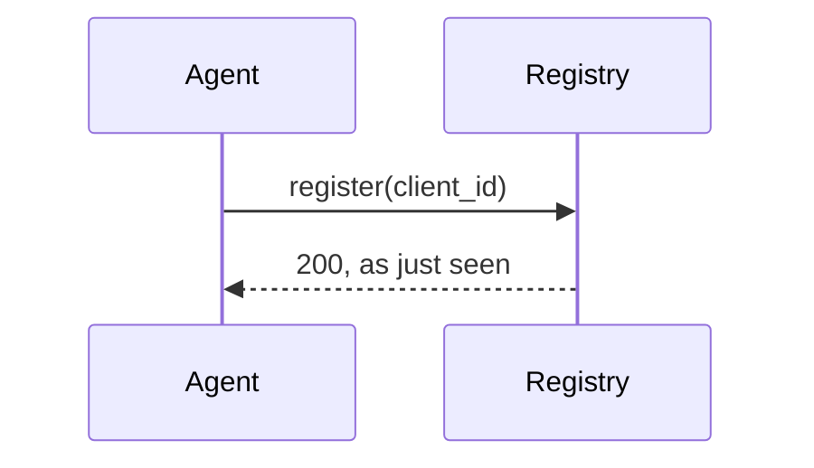

# Gateway — design

## 1. Overview

## 2. Elements

### 2.1 DSN-RCH-01 — Agent registry {#dsn-registry}

Keeps one record per client ID; registering again refreshes the record.

#### 2.1.1 Flow

#### 2.1.2 Traceability

Satisfies: REQ-RCH-01

### 2.2 `DSN-RCH-02` — Key guard

Checks the API key before any handler runs.

| Key | Status |
|---|---|
| missing | 401 |
| wrong | 401 |

- Satisfies: REQ-RCH-02
